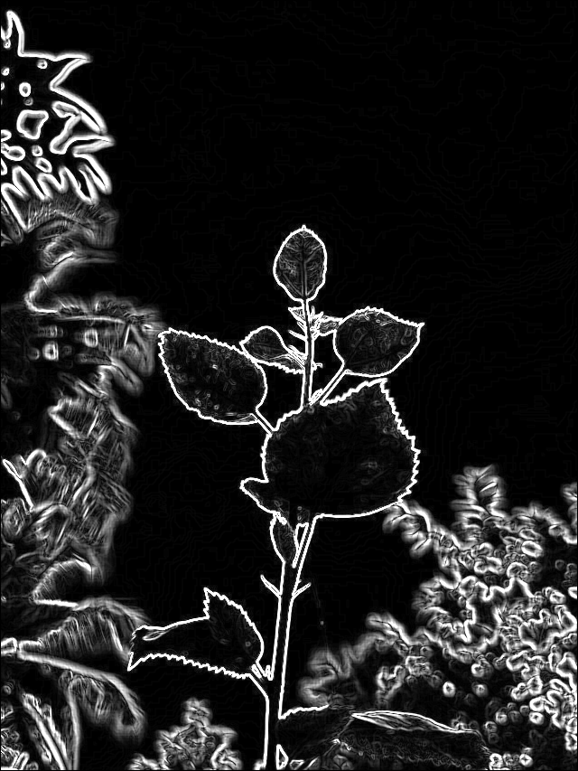

# Real-Time FPGA-Accelerated Sobel Edge Detector

A high-throughput, resource-efficient hardware accelerator for 2D **Sobel Edge Detection** ($3 \times 3$ kernel) implemented in SystemVerilog. The project explores three progressive hardware architectures—from an area-conservative baseline to a 1-cycle-per-pixel streaming accelerator and a 3-stage pipelined design—synthesized and verified on the **Xilinx Zynq-7020 SoC** (`xc7z020clg400-1`).

---

## Visual Results

The accelerator processes standard $640 \times 853$ 8-bit grayscale video frames in real time with high edge fidelity:

| Input Image (640 &times; 853) | Hardware Sobel Output (&#124;G<sub>x</sub>&#124; + &#124;G<sub>y</sub>&#124;) |
| :---: | :---: |
|  |  |

---

## Key Architectural Innovations

### 1. Baseline Architecture (`rtl/baseline/`)
- **Shared Arithmetic Datapath:** Reuses a single adder/subtractor and accumulator across a 16-state FSM.
- **Characteristics:** Minimal logic area, but requires 4–5 clock cycles per pixel ($3,040,078$ cycles per frame).

### 2. 1-Cycle Streaming Architecture (`rtl/optimized/`)
- **Dual BRAM Line Buffers:** Stores only 2 image rows in on-chip Block RAM (`RAMB18E1`), reducing BRAM usage by 33.3% compared to full 3-row buffers.
- **Column-Sum Shift Reuse ($c_2 \to c_1 \to c_0$):** Exploits horizontal sliding-window symmetry. Only the newly entered right column ($c_2$) is computed per cycle; earlier columns are shifted through 2-stage registers, slashing arithmetic operations by 50%.
- **Carry-Save Adder (CSA) Tree:** Sums positive and negative window terms in parallel without carry-propagation delay until the final stage.
- **Throughput:** Exactly **1 pixel per clock cycle** after initial 1,284-cycle buffer prefetch. Achieves a **5.57× speedup** over baseline.

### 3. 3-Stage Pipelined Architecture (`rtl/pipeline/`)
- **Stage 1 (Fetch & Column Sum):** BRAM line-buffer read + column sum $c_2$ accumulation.
- **Stage 2 (Gradient Accumulation):** Computes signed horizontal ($G_x$) and vertical ($G_y$) gradients via balanced CSA network.
- **Stage 3 (Magnitude & Saturation):** Computes Manhattan magnitude $|G_x| + |G_y|$ with dynamic-range saturation clamping to $[0, 255]$.
- **Timing Closure:** Shortens critical paths to 3 logic levels, boosting maximum clock frequency to **206.57 MHz**.

---

## Performance Benchmarks (Zynq-7020 @ 100 MHz)

Results extracted post-routing from Vivado 2022.2 for a standard $640 \times 853$ frame ($545,920$ pixels):

| Metric / Resource | Baseline Architecture | Optimized (1-Cycle) | 3-Stage Pipelined | Optimization Impact |
| :--- | :---: | :---: | :---: | :---: |
| **Clock Cycles / Frame** | 3,040,078 | **545,926** | **545,929** | **5.57× faster** |
| **Frame Latency @ 100MHz** | 30.40 ms | **5.46 ms** | **5.46 ms** | **-82% latency** |
| **Pixel Throughput** | 17.86 Mpx/s | **99.45 Mpx/s** | **99.45 Mpx/s** | **1 pixel/cycle** |
| **Frame Rate (FPS)** | 32.89 FPS | **183.18 FPS** | **183.17 FPS** | **Real-Time High-Speed** |
| **Worst Negative Slack (WNS)** | +3.299 ns | **+5.302 ns** | **+5.159 ns** | Timing passed |
| **Max Frequency ($F_{\max}$)** | 149.23 MHz | **212.86 MHz** | **206.57 MHz** | **+42.6% clock speed** |
| **Throughput @ $F_{\max}$** | ~49 FPS | **~390 FPS** | **~378 FPS** | Ultra-high frame rate |
| **Slice LUTs** | 148 (0.28%) | **121 (0.23%)** | **117 (0.22%)** | **-20.9% LUT area** |
| **Slice Registers (FF)** | 127 (0.12%) | **115 (0.11%)** | 178 (0.17%) | Pipeline register overhead |
| **Block RAM (RAMB18E1)** | 3 blocks (1.5 tiles) | **2 blocks (1.0 tile)** | **2 blocks (1.0 tile)** | **-33.3% BRAM** |
| **Total On-Chip Power** | 0.117 W | **0.111 W** | **0.112 W** | **111 mW (Ultra-low)** |

---

## Verification & SystemVerilog Assertions (SVA)

The design is rigorously verified across mathematical, algorithmic, and formal protocol levels:

### 1. SVA Properties (`sva/`)
- **`CTRL_SIG_RESET`:** Ensures all control outputs immediately deassert and `ready` asserts during asynchronous reset.
- **`OUTPUT_VALID_NO_X`:** Guarantees no unknown (`'X` or `'Z`) states appear when `valid` is asserted.
- **`DATAPATH_LATENCY`:** Formally verifies the exact $1,284$-cycle pipeline delay between start trigger and first valid pixel.
- **`SATURATION_CLAMP`:** Asserts that any gradient magnitude $\ge 255$ is strictly clamped to `8'hFF`.
- **`PROTOCOL_START_BUSY`:** Verifies mutual exclusion and handshaking protocol consistency.

### 2. Bug Injection Experiments
Five intentional hardware defects were tested to confirm assertion sensitivity:
- Control signal leakage on reset $\to$ Flagged by `controller_optimized_sva.sv`.
- Prefetch counter tampering $\to$ Flagged by datapath latency assertion.
- State-transition bypass on `start` $\to$ Handshake violation detected immediately.
- Clamping circuit omission $\to$ Saturation assertion triggered on pixel value $450 > 255$.

### 3. OpenCV Reference Comparison (`scripts/Checker.py`)
Hardware outputs were benchmarked against OpenCV double-precision reference across 5 diverse test images. Due to exact integer arithmetic alignment between `Input.py` and `Checker.py`, **the baseline active area produces 0.0000 mean error (0 max error)**.

---

## Repository Structure

```text
├── rtl/
│   ├── baseline/            # Multi-cycle baseline datapath and controller
│   ├── optimized/           # 1-cycle streaming core, BRAM line buffers & CSA
│   ├── pipeline/            # 3-stage pipelined datapath and controller
│   └── include/             # Shared CSA tree and Register building blocks
├── tb/
│   ├── baseline/            # Dedicated testbench for baseline architecture
│   ├── optimized/           # Dedicated testbench for 1-cycle streaming
│   ├── pipeline/            # Dedicated testbench for 3-stage pipeline
│   └── compare/             # Vtb_comparison (runs all 3 architectures in parallel)
├── sva/                     # SystemVerilog Assertion monitors for formal checking
├── sim/                     # Simulation outputs, comparison reports, and bug injection logs
├── scripts/
│   ├── Input.py             # Converts input.png -> image_in.hex (OpenCV-aligned)
│   ├── Checker.py           # Validates image_out.hex against OpenCV ground truth
│   └── run_sva_tests.sh     # Automates QuestaSim/Verilator SVA test suite
├── report/                  # Academic reports (VRDocs Typst & Markdown)
│   ├── report.md            # Persian academic report (گزارش فارسی)
│   └── report-en.md         # English academic report
└── README.md                # Project documentation
```

---

## Quick Start

### Prerequisites
- **Verilator** ($\ge 4.200$) or **QuestaSim / ModelSim**
- **Python 3** with `opencv-python` and `numpy`
- *(Optional)* **Xilinx Vivado 2022.2** for FPGA bitstream / synthesis

### 1. Prepare Input Image
Place your target image as `input.png` in the project root, then generate the hardware hex stream:
```bash
python3 scripts/Input.py
# Outputs: image_in.hex (640x853 8-bit hex pixels)
```

### 2. Compile & Run Simulation (Verilator)
```bash
# Compile parallel comparison testbench
verilator --binary -j 0 --trace -Wall \
  -Irtl/include -Irtl/baseline -Irtl/optimized -Irtl/pipeline -Isva \
  tb/compare/tb_comparison.sv --top-module tb_comparison

# Execute simulation
./obj_dir/Vtb_comparison
```

### 3. Verify Output with OpenCV Ground Truth
```bash
python3 scripts/Checker.py
# Outputs: Mean error when comparing:0.10
# Generated image: hardware_sobel_result.png
```

---

## Academic Context

Developed as part of the **FPGA-based Embedded Systems Design** graduate curriculum:
- **Institution:** University of Tehran, Department of Electrical and Computer Engineering
- **Instructor:** Dr. Bijan Alizadeh
- **Author:** Mohammad Khoshroo

---

## License

This project is licensed under the [MIT License](LICENSE) - open for academic and research use.
