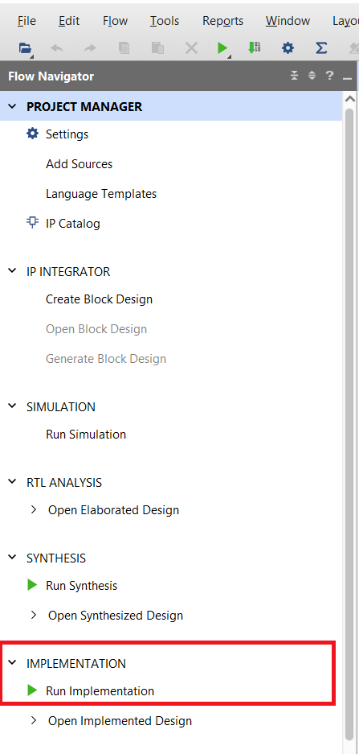
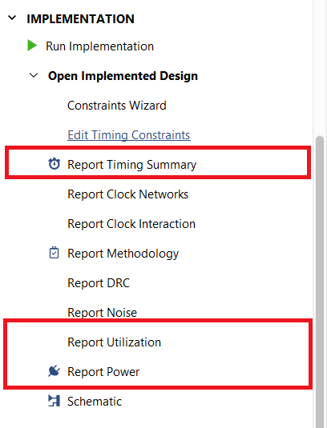

<div align="center">

<p align="center">
  
  &nbsp;&nbsp;&nbsp;&nbsp;&nbsp;&nbsp;&nbsp;&nbsp;&nbsp;&nbsp;&nbsp;&nbsp;&nbsp;&nbsp;&nbsp;&nbsp;&nbsp;&nbsp;&nbsp;&nbsp;&nbsp;&nbsp;&nbsp;&nbsp;&nbsp;&nbsp;&nbsp;&nbsp;
  
</p>

**بسمه تعالی**

# درس طراحی سیستم‌های نهفته مبتنی بر FPGA
## تمرین کامپیوتری ۱: پیاده‌سازی سخت‌افزاری فیلتر Sobel

**دانشکدگان فنی دانشگاه تهران**  
**دانشکده مهندسی برق و کامپیوتر**  
**مدرس:** دکتر بیژن علیزاده  

**دستیاران آموزشی:**  
بردیا فاطمی &mdash; [bardia.fatemi@ut.ac.ir](mailto:bardia.fatemi@ut.ac.ir) (`@BardiaFatemi`)  
پویا صالحی &mdash; [pooya.salehi.82@ut.ac.ir](mailto:pooya.salehi.82@ut.ac.ir) (`@A_P_82`)  

**نیم‌سال اول ۱۴۰۵-۱۴۰۶**

</div>

---

### اهداف تمرین کامپیوتری:

- [x] طراحی مسیر داده (Datapath) و کنترلر (Controller) برای پیاده‌سازی سخت‌افزاری الگوریتم Sobel.
- [x] سنتز طراحی و بررسی و بهینه‌سازی منابع سخت‌افزاری مصرف‌شده.
- [x] استفاده از Assertion برای بررسی صحت عملکرد طراحی.
- [x] ارزیابی صحت خروجی سخت‌افزار با استفاده از OpenCV.

### موارد خواسته شده:

۱. طراحی مسیر داده و کنترلر الگوریتم Sobel.  
۲. سنتز طراحی و بررسی میزان مصرف منابع و اعمال بهینه‌سازی‌های لازم.  
۳. افزودن Assertionهای مناسب و استفاده از آن‌ها برای Verification.  
۴. اجرای تست‌بنچ و مقایسه خروجی طراحی با خروجی مرجع.  

---

## ۱. طراحی مسیر داده و کنترلر Sobel

### ۱-۱. الگوریتم Sobel

الگوریتم Sobel یکی از روش‌های رایج تشخیص لبه در پردازش تصویر است. در این روش، تغییرات شدت روشنایی در راستای افقی و عمودی با استفاده از یک پنجره $3 \times 3$ بررسی می‌شود. برای این منظور، دو مؤلفه گرادیان $G_x$ و $G_y$ مطابق روابط زیر محاسبه می‌شوند:

$$G_x = \begin{bmatrix} -1 & 0 & +1 \\ -2 & 0 & +2 \\ -1 & 0 & +1 \end{bmatrix} * I \tag{۱-۱}$$

$$G_y = \begin{bmatrix} -1 & -2 & -1 \\ 0 & 0 & 0 \\ +1 & +2 & +1 \end{bmatrix} * I \tag{۲-۱}$$

در این تمرین، مقدار خروجی هر پیکسل از رابطه زیر به دست می‌آید:

$$G = |G_x| + |G_y| \tag{۳-۱}$$

مقدار خروجی باید در بازه ۸ بیتی 0 تا 255 قرار گیرد. در صورت بیشتر بودن مقدار محاسبه‌شده از 255، مقدار خروجی برابر 255 در نظر گرفته شود.

### ۲-۱. Line Buffer

در پردازش جریانی تصاویر، برای تشکیل پنجره $3 \times 3$ لازم است علاوه بر پیکسل فعلی، پیکسل‌های مربوط به سطرهای قبلی نیز در دسترس باشند. Line Buffer ساختاری برای ذخیره موقت سطرهای قبلی تصویر است که امکان دسترسی به پیکسل‌های مورد نیاز از چند سطر متوالی را فراهم می‌کند. با استفاده از Line Buffer و شیفت رجیسترها می‌توان پنجره $3 \times 3$ را به‌صورت پیوسته و هم‌زمان با ورود پیکسل‌های تصویر تشکیل داد.

### ۳-۱. طراحی مسیر داده و کنترلر

الگوریتم Sobel را به‌صورت سخت‌افزاری و در قالب یک طراحی RTL پیاده‌سازی کنید. طراحی باید شامل مسیر داده و منطق کنترلی مورد نیاز برای دریافت پیکسل‌ها، تشکیل پنجره $3 \times 3$، انجام محاسبات Sobel و تولید خروجی باشد.

در طراحی مسیر داده، موارد زیر باید در نظر گرفته شوند:

* دریافت پیکسل‌های ورودی به‌صورت ۸ بیتی.
* تشکیل پنجره $3 \times 3$ برای پردازش هر پیکسل.
* نگهداری سطرهای مورد نیاز تصویر و جابه‌جایی پیکسل‌ها با یک ساختار مناسب مانند Line Buffer.
* محاسبه $G_x$ و $G_y$ با عرض بیت مناسب برای جلوگیری از Overflow.
* محاسبه قدرمطلق مؤلفه‌های گرادیان.
* محاسبه مقدار خروجی و اعمال محدودسازی به بازه ۸ بیتی.
* مدیریت تأخیر داده در صورت استفاده از چند مرحله محاسباتی یا Pipeline.
* در نظر گرفتن یک سیگنال وقفه برای اعلام پایان کامل عملیات پردازش.

Controller شما باید زمان دریافت داده، آماده‌شدن پنجره، معتبر بودن خروجی و پایان پردازش را مدیریت کند. در صورت استفاده از FSM، حالت‌ها و شرایط انتقال بین حالت‌ها را مشخص کنید. در طراحی خود توجه داشته باشید که همزمانی سیگنال‌های کنترلی با داده‌های پردازش‌شده باید رعایت شود.

### ۴-۱. Testbench و آماده‌سازی تصویر ورودی

ابتدا تصویر ورودی `input.png` را با استفاده از اسکریپت `Input.py` به فایل `image_in.hex` تبدیل کنید. تصویر ابتدا به حالت خاکستری تبدیل شده و سپس به ابعاد $640 \times 853$ تغییر اندازه داده می‌شود. مقدار هر پیکسل به‌صورت یک مقدار ۸ بیتی در فایل هگز ذخیره می‌شود.

برای تولید فایل ورودی، دستور زیر را اجرا کنید:

```bash
python Input.py
```

سپس در Testbench، فایل `image_in.hex` را در حافظه بارگذاری کرده و داده‌های تصویر را به‌ترتیب به ورودی طراحی اعمال کنید. برای بارگذاری فایل hex می‌توانید از دستور `$readmemh` استفاده کنید.

تست‌بنچ باید موارد زیر را انجام دهد:

۱. بارگذاری کامل داده‌های `image_in.hex` در حافظه.  
۲. اعمال ترتیبی پیکسل‌ها به ورودی طراحی.  
۳. اعمال Clock و سیگنال‌های کنترلی مورد نیاز.  
۴. در نظر گرفتن تأخیر ایجادشده در مسیر داده.  
۵. ذخیره تنها خروجی‌های معتبر در فایل `image_out.hex`.  

ترتیب پیکسل‌های ورودی و خروجی باید با ترتیب ذخیره‌سازی تصویر یکسان باشد. تعداد سیکل‌های تأخیر مسیر داده نیز باید در Testbench لحاظ شود.

### ۵-۱. بررسی خروجی

* برای اجرای مرحله بررسی و مقایسه خروجی با مرجع OpenCV، ابتدا کتابخانه OpenCV را در محیط پایتون نصب کنید.

در صورت استفاده از pip، دستور زیر را اجرا کنید:

```bash
pip install opencv-python
```

پس از اجرای موفق Testbench و تولید فایل `image_out.hex`، اسکریپت `Checker.py` را اجرا کنید:

```bash
python Checker.py
```

کد `Checker.py`، خروجی سخت‌افزار یعنی فایل `image_out.hex` را با خروجی مرجع Sobel مقایسه کرده و مقدار خطای به‌دست‌آمده را گزارش می‌کند. این کد همچنین با استفاده از فایل `image_out.hex` تصویر حاصل از خروجی سخت‌افزار با نام `hardware_sobel_result.png` را تولید می‌کند. توجه کنید که نتیجه اجرای اسکریپت `Checker.py` را در گزارش خود ثبت کنید.

<div align="center">

|  |  |
| :---: | :---: |
| **شکل ۱-۱:** تصویر ورودی | **شکل ۲-۱:** تصویر خروجی پس از اجرای کد Checker.py |

</div>

### ۶-۱. نتایج مورد انتظار

در پایان بخش اول، موارد زیر را ارائه کنید:

۱. کد RTL مربوط به مسیر داده و کنترلر طراحی‌شده.  
۲. دیاگرام مسیر داده و ساختار کنترلی طراحی‌شده.  
۳. Testbench مورد استفاده برای شبیه‌سازی طراحی.  
۴. فایل `image_out.hex` حاصل از اجرای Testbench.  
۵. نتیجه اجرای اسکریپت `Checker.py`.  
۶. تصویر خروجی حاصل از اجرای طراحی سخت‌افزاری.  
۷. توضیح مختصر درباره معماری انتخاب‌شده و نحوه مدیریت تأخیر داده و سیگنال‌های معتبر.  

---

## ۲. سنتز و بررسی منابع سخت‌افزاری

در این بخش، طراحی RTL بخش قبل را در محیط Vivado برای تراشه Xilinx Zynq-7020 سنتز کرده و نتایج حاصل از سنتز، میزان مصرف منابع سخت‌افزاری و وضعیت زمان‌بندی طراحی را بررسی کنید.

هدف این بخش، آشنایی با فرآیند ایجاد پروژه، تعریف طراحی به عنوان Top Module، اجرای Synthesis و Implementation و بررسی گزارش‌های منابع و زمان‌بندی است.

### ۱-۲. ایجاد پروژه در Vivado

یک پروژه جدید در نرم‌افزار Vivado ایجاد کنید. در هنگام ایجاد پروژه، نوع پروژه را به صورت RTL Project انتخاب کرده و فایل‌های SystemVerilog طراحی خود را به پروژه اضافه کنید.

در مرحله انتخاب قطعه، شماره قطعه زیر را انتخاب کنید:

```text
xc7z020clg400-1
```

پس از ایجاد پروژه، اطمینان حاصل کنید که:

* تمامی فایل‌های مورد نیاز طراحی به پروژه اضافه شده باشند.
* ماژول اصلی طراحی به عنوان Top Module انتخاب شده باشد.
* فایل‌های مربوط به تست‌بنچ در بخش Simulation Sources قرار گرفته باشند.
* فایل‌های طراحی سخت‌افزاری در بخش Design Sources قرار گرفته باشند.
* شماره قطعه انتخاب‌شده `xc7z020clg400-1` باشد.

### ۲-۲. ساختار پروژه و اجرای Synthesis

پس از ایجاد پروژه، ساختار طراحی را در بخش Sources بررسی کنید. ماژول اصلی باید به عنوان Top Module مشخص شده باشد و تمامی زیرماژول‌های مورد استفاده در طراحی به درستی توسط Vivado شناسایی شوند.

اطمینان حاصل کنید که در صورت وجود خطا یا هشدار مهم در بخش Messages، صحت ساختار طراحی را بررسی کرده و موارد مربوط را برطرف کنید.

پس از آماده‌سازی پروژه، فرآیند Synthesis را از محیط Vivado اجرا کنید.  
پس از اتمام موفقیت‌آمیز سنتز، نتایج حاصل از اجرای آن را در محیط Vivado بررسی کنید.

### ۳-۲. اجرای Implementation

پس از اجرای موفقیت‌آمیز Synthesis، فرآیند Implementation را اجرا کنید. پس از پایان این مرحله، گزارش‌های تولیدشده توسط Vivado را بررسی کنید.

<div align="center">



**شکل ۲-۳:** محیط Vivado و بخش Implementation پس از ساخت پروژه

</div>

### ۴-۲. تنظیم محدودیت Clock

<div align="center">



**شکل ۲-۴:** گزارش‌های Timing Summary و Utilization در محیط Vivado

</div>

برای بررسی صحیح زمان‌بندی طراحی، فرکانس Clock ورودی را برابر با 100 مگاهرتز در نظر بگیرید. بنابراین، دوره Clock برابر با 10 نانوثانیه خواهد بود.

محدودیت Clock را در فایل XDC پروژه تعریف کنید:

```tcl
create_clock -period 10.00 [get_ports clk]
```

پس از اعمال محدودیت Clock، فرآیندهای Synthesis و Implementation را مجدداً اجرا کرده و گزارش زمان‌بندی را بررسی کنید.

### ۵-۲. بررسی منابع سخت‌افزاری

پس از اجرای Implementation، میزان مصرف منابع سخت‌افزاری طراحی را از گزارش Utilization استخراج کنید.

موارد زیر را در گزارش خود ثبت کنید:

* تعداد و درصد استفاده از LUT
* تعداد و درصد استفاده از Flip-Flop
* تعداد و درصد استفاده از BRAM
* تعداد و درصد استفاده از منابع IO

اطلاعات استخراج‌شده را در قالب جدول زیر ارائه کنید.

| منبع | مقدار مصرف‌شده | درصد استفاده |
| :---: | :---: | :---: |
| **LUT** | | |
| **Flip-Flop** | | |
| **BRAM** | | |
| **IO** | | |

<div align="center">

**جدول ۲-۱:** منابع سخت‌افزاری مصرف‌شده توسط طراحی

</div>

### ۶-۲. بررسی زمان‌بندی طراحی

گزارش Timing Summary را پس از اجرای Implementation بررسی کنید و موارد زیر را در گزارش خود ثبت کنید:

* دوره Clock تعریف‌شده
* فرکانس Clock
* مقدار WNS
* مقدار TNS
* بیشترین تأخیر گزارش‌شده در مسیرهای طراحی
* وضعیت نهایی زمان‌بندی طراحی

مشخص کنید که آیا طراحی با محدودیت Clock، 100 مگاهرتز از نظر زمان‌بندی قابل قبول است یا خیر.

### ۷-۲. محاسبه حداکثر فرکانس کاری

با استفاده از نتایج گزارش زمان‌بندی، حداکثر فرکانس کاری قابل دستیابی برای طراحی را محاسبه کنید.

در صورت برقرار بودن شرایط زمان‌بندی، می‌توان از رابطه زیر استفاده کرد:

$$T_{\min} = T_{\text{clk}} - \text{WNS}$$

سپس حداکثر فرکانس کاری را از رابطه زیر به دست آورید:

$$F_{\max} = \frac{1}{T_{\min}}$$

مقدار به دست آمده را با فرکانس 100 مگاهرتز مقایسه کرده و نتیجه را در گزارش خود توضیح دهید.

### ۸-۲. بهینه‌سازی طراحی (امتیازی)

در صورت تمایل، طراحی خود را از نظر مصرف منابع و یا زمان‌بندی بهینه کنید. برای مثال، می‌توانید تغییرات معماری یا ساختاری مناسب را اعمال کرده و تأثیر آن‌ها را بر منابع مصرفی و عملکرد زمانی بررسی کنید.

نتایج طراحی اولیه و طراحی بهینه‌شده را با یکدیگر مقایسه کرده و تغییرات ایجادشده را در گزارش توضیح دهید.

### ۹-۲. نتایج مورد انتظار

در گزارش نهایی این بخش، موارد زیر باید ارائه شوند:

۱. ساختار پروژه و نحوه تعریف Top Module  
۲. نتایج اجرای Synthesis  
۳. نتایج اجرای Implementation  
۴. جدول منابع سخت‌افزاری مصرف‌شده شامل LUT، Flip-Flop، BRAM و IO  
۵. گزارش زمان‌بندی شامل WNS، TNS و وضعیت نهایی زمان‌بندی  
۶. محاسبه و گزارش حداکثر فرکانس کاری طراحی  
۷. در صورت انجام بهینه‌سازی، مقایسه نتایج طراحی اولیه و طراحی بهینه‌شده  

---

## ۳. بررسی صحت عملکرد با استفاده از Assertion

با توجه به توضیحات و مفاهیم مربوط به Assertion که در کلاس ارائه شده است، در این بخش صحت عملکرد طراحی سخت‌افزاری Sobel را با استفاده از Assertion بررسی کنید. هدف این بخش، تعریف ویژگی‌های قابل بررسی برای طراحی و اطمینان از برقراری آن‌ها در طول شبیه‌سازی است.

برای اجرای این بخش، از نرم‌افزار QuestaSim استفاده کنید. توجه داشته باشید که Assertionهای مورد استفاده در این بخش در محیط ModelSim قابل اجرا نیستند؛ بنابراین لازم است نرم‌افزار QuestaSim را بر روی سیستم خود نصب و تنظیم کنید.

در این بخش، Assertionها باید در محیط شبیه‌سازی و در کنار Test Bench مورد استفاده قرار گیرند. هر Assertion باید یک ویژگی مشخص از رفتار مورد انتظار طراحی را بررسی کند.

### ۱-۳. آشنایی با Assertion

Assertion روشی برای بیان یک ویژگی مورد انتظار از رفتار طراحی است که در هنگام شبیه‌سازی به‌صورت خودکار بررسی می‌شود. در صورتی که رفتار واقعی طراحی با ویژگی تعریف‌شده مطابقت نداشته باشد، Assertion نقض شده و خطا در محیط شبیه‌سازی گزارش می‌شود.

در این بخش، با استفاده از مفاهیمی که در کلاس درباره Assertion و نحوه استفاده از آن‌ها در فرآیند Verification فراگرفته‌اید، چند ویژگی مهم از طراحی Sobel را مشخص کرده و برای آن‌ها Assertion مناسب تعریف کنید.

### ۲-۳. تعریف ویژگی‌های مورد بررسی

برای طراحی خود، چند ویژگی مهم و قابل بررسی را شناسایی کرده و برای هرکدام یک Assertion مناسب تعریف کنید.

حداقل موارد زیر باید بررسی شوند:

**۱. وضعیت خروجی در هنگام Reset:**  
بررسی کنید که در هنگام فعال بودن Reset، طراحی در وضعیت مشخص و مورد انتظار قرار داشته باشد و خروجی به‌عنوان یک داده معتبر تولید نشود.

**۲. معتبر بودن خروجی:**  
بررسی کنید که خروجی طراحی فقط در زمانی که سیگنال اعتبار خروجی فعال است، به‌عنوان یک خروجی معتبر در نظر گرفته شود.

**۳. تأخیر مسیر داده:**  
با توجه به معماری طراحی، تعداد سیکل‌های لازم بین دریافت داده و تولید خروجی را مشخص کنید و با استفاده از Assertion این تأخیر را بررسی کنید.

**۴. محدوده خروجی:**  
بررسی کنید که مقدار خروجی Sobel همواره در محدوده مورد انتظار یک مقدار ۸ بیتی قرار داشته باشد.

**۵. رفتار سیگنال‌های کنترلی:**  
حداقل یک ویژگی زمانی برای سیگنال‌های کنترلی طراحی تعریف کنید. این ویژگی باید رابطه صحیح بین سیگنال‌های ورودی، وضعیت پردازش و خروجی را بررسی کند.

### ۳-۳. پیاده‌سازی Assertionها

Assertionهای تعریف‌شده را در محیط QuestaSim و در کنار تست‌بنچ طراحی خود پیاده‌سازی کنید. برای هر Assertion، مشخص کنید که چه ویژگی‌ای را بررسی می‌کند و در صورت نقض آن، چه خطایی باید گزارش شود.

در صورت استفاده از SystemVerilog Assertions، از ساختارهای زمانی مناسب برای بیان رابطه بین سیگنال‌ها در سیکل‌های مختلف استفاده کنید.

برای هر Assertion حداقل موارد زیر را در نظر بگیرید:

* شرطی که باید برقرار باشد.
* سیگنال یا سیگنال‌های مورد بررسی.
* رابطه زمانی بین رویدادها، در صورت وجود.
* پیام خطای مناسب در صورت نقض ویژگی.

تعداد Assertionهای طراحی باید به گونه‌ای باشد که تمام ویژگی‌های ذکرشده در بخش قبل را پوشش دهد.

### ۴-۳. بررسی عملکرد Assertionها

پس از اضافه کردن Assertionها، شبیه‌سازی طراحی را در محیط QuestaSim اجرا کرده و وضعیت تمام Assertionها را بررسی کنید.

در صورتی که تمام ویژگی‌های تعریف‌شده در طراحی برقرار باشند، هیچ‌یک از Assertionها نباید در طول اجرای صحیح تست‌بنچ نقض شوند.

برای هر Assertion موارد زیر را بررسی و در گزارش ثبت کنید:

* نام یا شناسه Assertion
* ویژگی مورد بررسی
* نتیجه اجرای Assertion
* تعداد دفعات فعال شدن یا بررسی آن، در صورت قابل دسترس بودن در محیط شبیه‌سازی

### ۵-۳. ایجاد شرایط نقض Assertion (امتیازی)

برای اطمینان از عملکرد صحیح Assertionها، حداقل یکی از ویژگی‌های تعریف‌شده را به‌صورت کنترل‌شده نقض کنید.

برای مثال، می‌توانید در محیط تست شرایطی ایجاد کنید که یکی از روابط زمانی مورد انتظار بین ورودی و خروجی برقرار نباشد. سپس شبیه‌سازی را اجرا کرده و بررسی کنید که Assertion مربوطه نقض را تشخیص داده و پیام خطای مناسب را گزارش می‌کند.

پس از انجام این بررسی، تغییر ایجادشده را حذف کرده و طراحی را به حالت صحیح بازگردانید. سپس شبیه‌سازی نهایی را اجرا کنید و از عدم وجود خطای Assertion اطمینان حاصل کنید.

### ۶-۳. نتایج مورد انتظار

در گزارش این بخش، موارد زیر را ارائه کنید:

۱. فهرست ویژگی‌های مورد بررسی و توضیح مختصر آن‌ها.  
۲. کد Assertionهای نوشته‌شده.  
۳. توضیح رابطه زمانی و عملکردی مورد بررسی توسط هر Assertion.  
۴. نتیجه اجرای شبیه‌سازی در حالت صحیح طراحی.  
۵. در صورت انجام بخش امتیازی، نتیجه آزمایش نقض کنترل‌شده حداقل یک Assertion و پیام خطای مشاهده‌شده.  
۶. نتیجه اجرای نهایی پس از اصلاح طراحی و اطمینان از عدم وجود نقض Assertion.  

---

## ۴. نکات تحویل

> [!IMPORTANT]
> **این تمرین به‌صورت کاملاً انفرادی میباشد و هر دانشجو باید فایل تحویلی خود را به‌صورت مستقل ارسال کند.**

در پایان تمرین، تمامی فایل‌های مورد نیاز را در قالب یک فایل فشرده با فرمت ZIP یا RAR تحویل دهید. نام فایل فشرده باید دقیقاً مطابق قالب زیر باشد:

```text
FullName_STDnumber_CA#1_FPGA.zip
```

فایل فشرده نهایی باید شامل موارد زیر باشد:

**۱. فایل گزارش تمرین:**  
گزارش نهایی شامل توضیحات، نتایج شبیه‌سازی، نتایج Synthesis و Implementation، بررسی منابع، زمان‌بندی و نتایج Assertionها.

**۲. فایل‌های طراحی RTL:**  
تمامی فایل‌های SystemVerilog مربوط به طراحی سخت‌افزاری Sobel و ماژول‌های مورد استفاده.

**۳. تست‌بنچ:**  
فایل یا فایل‌های تست‌بنچ مورد استفاده برای شبیه‌سازی طراحی.

**۴. فایل‌های ورودی و خروجی تصویر:**  
فایل `image_in.hex` و فایل `image_out.hex` حاصل از اجرای تست‌بنچ.

**۵. اسکریپت‌های پایتون:**  
فایل‌های `Input.py` و `Checker.py` توسط دستیاران آموزشی در اختیار شما قرار داده شده.  
در صورتی که این فایل‌ها را بدون تغییر استفاده کرده‌اید، نیازی به تحویل مجدد آن‌ها نیست. در صورت ایجاد هرگونه تغییر در فایل‌های `Input.py` یا `Checker.py`، نسخه تغییریافته باید حتماً در فایل فشرده نهایی قرار داده شود.

**۶. نتایج بررسی خروجی:**  
نتیجه اجرای `Checker.py` و تصویر خروجی حاصل از اجرای طراحی سخت‌افزاری.

**۷. نتایج سنتز و پیاده‌سازی:**  
نتایج مربوط به Synthesis و Implementation، شامل میزان مصرف منابع سخت‌افزاری و گزارش زمان‌بندی.

**۸. کد Assertion:**  
تمامی Assertionهای نوشته‌شده و فایل‌های مورد نیاز برای اجرای آن‌ها در QuestaSim.

**۹. نتایج شبیه‌سازی Assertion:**  
نتیجه اجرای Assertionها در حالت صحیح طراحی و در صورت انجام بخش امتیازی، نتیجه آزمایش نقض کنترل‌شده حداقل یک Assertion.

**۱۰. فایل پروژه:**  
فایل‌های لازم برای باز کردن و اجرای پروژه در محیط Vivado و در صورت نیاز فایل‌های پروژه QuestaSim.

> [!WARNING]
> **تمامی فایل‌های تحویلی باید مربوط به کار خود دانشجو بوده و به‌صورت منظم و قابل اجرا ارائه شوند. فایل فشرده نهایی باید با فرمت تعیین شده در این بخش ارسال شود.**
