# 1- مقدمه {#sec-intro}

الگوریتم سوبل از دو ماسک کانولوشن $3 \times 3$ برای محاسبه نرخ تغییرات روشنایی در امتداد محور افقی ($G_x$) و محور عمودی ($G_y$) بهره می‌گیرد:

$$
G_x = \begin{bmatrix} -1 & 0 & +1 \\ -2 & 0 & +2 \\ -1 & 0 & +1 \end{bmatrix} * I
\tag{۱-۱}
$$

$$
G_y = \begin{bmatrix} -1 & -2 & -1 \\ 0 & 0 & 0 \\ +1 & +2 & +1 \end{bmatrix} * I
\tag{۲-۱}
$$

در این تمرین، دامنه گرادیان با استفاده از تقریب نرم‌افزاری استاندارد (مجموع قدرمطلق مؤلفه‌ها) مطابق با رابطه زیر به دست می‌آید:

$$
G = |G_x| + |G_y|
\tag{۳-۱}
$$

به منظور جلوگیری از خطای سرریز (<en>Overflow</en>) در جریان محاسبات حسابی، دامنه مقادیر محاسبه‌شده باید با عرض بیت کافی (۱۱ بیت) نگهداری شود. در مرحله نهایی، مقدار گرادیان در بازه دینامیکی ۸ بیتی استاندارد ($[0, 255]$) محدود (<en>Clamped/Saturated</en>) می‌شود:

$$
G_{\text{sat}} = \begin{cases} 255 & \text{if } G > 255 \\ G[7:0] & \text{if } G \le 255 \end{cases}
\tag{۴-۱}
$$

<mybox type="info">

تصویر ورودی تمرین دارای ابعاد $640 \times 853$ (معادل ۵۴۵,۹۲۰ پیکسل) است. از آنجا که پنجره کانولوشن $3 \times 3$ به یک حاشیه ۱ پیکسلی دور تا دور تصویر نیاز دارد، ناحیه فعال خروجی دارای ابعاد $638 \times 851$ (معادل ۵۴۲,۹۳۸ پیکسل معتبر) خواهد بود.

</mybox>

# 2- معماری سخت‌افزاری و طراحی مدار {#sec-hardware-arch}

در این بخش، سه معماری سخت‌افزاری طراحی و پیاده‌سازی‌شده شامل معماری پایه، معماری بهینه‌شده جریانی و معماری پایپ‌لاین ۳ مرحله‌ای به همراه ساختار مسیر داده (<en>Datapath</en>) و ماشین وضعیت کنترلر (<en>Controller FSM</en>) به تفصیل بررسی می‌گردند.

---

## 2-1- معماری پایه (Baseline Architecture) {#sec-baseline-arch}

معماری پایه با رویکرد کمینه‌سازی مساحت منطقی از طریق اشتراک‌گذاری زمانی (<en>Time Multiplexing</en>) عملگرهای محاسباتی طراحی شده است.

### الف) مسیر داده پایه (Baseline Datapath)
در این معماری از یک ماژول حسابی اشتراکی برای محاسبه هر دو مؤلفه $G_x$ و $G_y$ استفاده می‌شود. ورودی‌های ماتریس پنجره با توجه به سیگنال کنترلی `xy_ctrl` به یک درخت جمع‌کننده ذخیره نقلی (<en>Carry-Save Adder - CSA Tree</en>) اعمال می‌شوند. ساختار محاسباتی شامل موارد زیر است:


- **درخت ۴ مرحله‌ای CSA:** جهت ادغام ۶ پیکسل فعال پنجره سوبل در قالب مؤلفه‌های مجموع و نقلی با عرض ۱۱ بیت.
- **مالتی‌پارامترهای XM و YM:** این مالتی‌پلکسرهای ۴ به ۱، بردارهای مجموع و نقلی خروجی درخت CSA، مقادیر معکوس‌شده ثبات‌های بازخورد جهت تفریق و اعمال متمم دو، و مقادیر صفر را به ورودی جمع‌کننده نهایی (<en>CPA / Adder</en>) هدایت می‌کنند.
- **ثبات‌های بازخورد `reg_Gx` و `reg_Gy`:** نگهداری نتایج واسط گرادیان‌ها در سیکل‌های محاسباتی متوالی.
- **تأخیر محاسباتی هر پیکسل:** پردازش هر پیکسل در ۴ سیکل متوالی انجام می‌پذیرد (محاسبه $G_x$، در صورت منفی بودن اعمال متمم دو، محاسبه $G_y$، و نهایتاً جمع قدرمطلق‌ها و اعمال اشباع).

<fig id="fig-baseline-datapath" caption="شماتیک کامل مسیر داده معماری پایه">

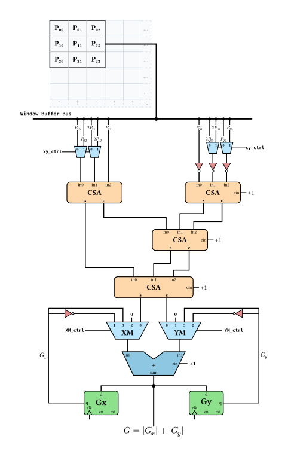

</fig>


### ب) ماشین وضعیت کنترلر پایه (Baseline Controller FSM)
کنترلر شتابدهنده به صورت زیر کار می‌کند:

۱. `IDLE`: انتظار برای فعال شدن سیگنال شروع (`start`) و ریست شمارنده‌ها.

۲. `LOAD_CHECK`: بررسی وضعیت پر شدن بافرهای سطری اولیه.

۳. `LOAD_ROW`: ذخیره‌سازی داده‌های سطر جدید در بافر سطری و شیفت اشاره‌گر سطرها.

۴. `PREPARE_WIN`: پر کردن دو ستون اولیه ماتریس پنجره لغزان.

۵. `CALC_GX`: محاسبه مؤلفه افقی گرادیان با هدایت سیگنال‌های کنترلی $X$.

۶. `NEG_GX`: در صورت منفی بودن بیت علامت $G_x[10]$، هدایت متمم دو از طریق رجیستر بازخورد.

۷. `CALC_GY`: محاسبه مؤلفه عمودی گرادیان با هدایت سیگنال‌های کنترلی $Y$.

۸. `NEG_GY`: اعمال متمم دو در صورت منفی بودن بیت علامت $G_y[10]$.

۹. `DONE_PIXEL`: فعال‌سازی پالس `valid_pixel`، اعمال اشباع خروجی و بررسی شرایط 
انتهای سطر و تصویر.

۱۰. `DONE`: فعال‌سازی پالس وقفه پایان عملیات پردازش تصویر (`done`).

<fig id="fig-baseline-controller" caption="نمودار حالت‌های ماشین وضعیت کنترلر پایه">

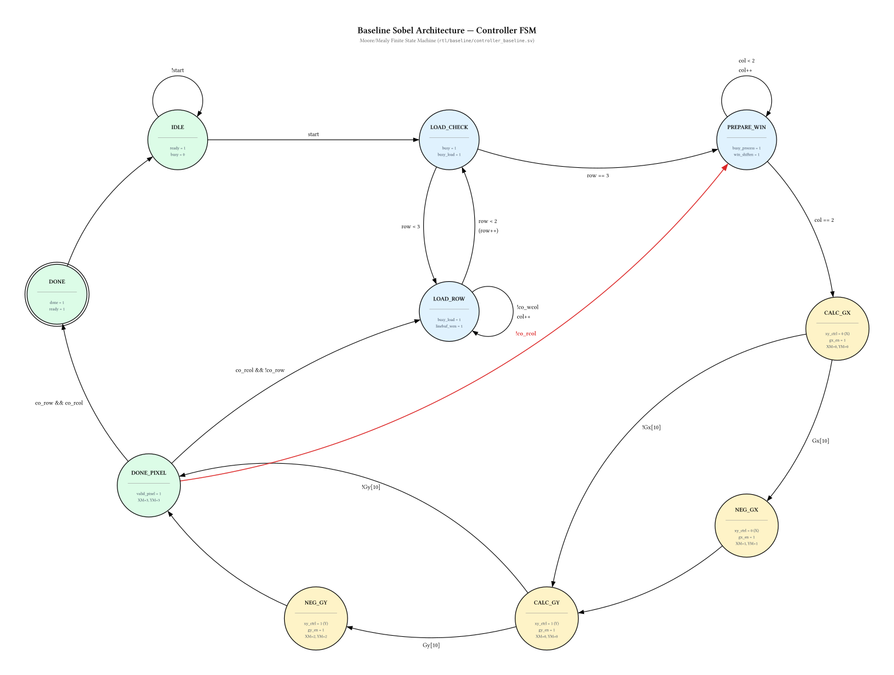

</fig>


<breakpage />

## 2-2- معماری بهینه‌شده جریانی (Optimized <en>1-Cycle</en> Streaming) {#sec-optimized-arch}

معماری پایه با وجود مصرف کم منابع منطقی، به دلیل نیاز به ۴ الی ۵ سیکل کلاک به ازای هر پیکسل، گذردهی تصویر را به شدت محدود می‌کرد ($3,040,078$ سیکل برای پردازش تصویر).
مجموع ستونی هر ستون از پنجره لغزان به صورت زیر تعریف می‌گردد:

$$
c_k = P_{0,k} + 2 \cdot P_{1,k} + P_{2,k}
\tag{۶-۲}
$$

با شیفت پنجره در امتداد افقی، ستون سمت راست فعلی ($c_2$) در سیکل کلاک بعدی به ستون میانی ($c_1$) و در سیکل پس از آن به ستون چپ ($c_0$) تبدیل می‌شود؛ بنابراین نیازی به محاسبه مجدد ۶ پیکسل در هر سیکل کلاک نیست؛ بلکه مدار سخت‌افزاری تنها مجموع ستون جدید ($c_2$) را محاسبه کرده و آن را در یک خط تأخیر دو مرحله‌ای ثبات‌ها شیفت می‌دهد:

$$
c_2 \xrightarrow{\text{clk}} c_1 \xrightarrow{\text{clk}} c_0
\tag{۷-۲}
$$

سپس گرادیان افقی به سادگی از تفریق ستون اول از ستون سوم به دست می‌آید:

$$
G_x = c_2 - c_0 = c_2 + \overline{c_0} + 1
\tag{۸-۲}
$$


در معماری پایه، قدرمطلق با بررسی بیت علامت و اجرای یک سیکل تفریق متمم دو صورت می‌گرفت. در معماری بهینه‌شده، محاسبه $|G_x|$ و $|G_y|$ به کمک گیت‌های موازی <en>XOR</en> با استفاده از بیت علامت گرادیان ($S = G[10]$) انجام می‌گیرد:

$$
|G| = (G \oplus \{11\{S\}\}) + S
\tag{۹-۲}
$$

این مقدار مستقیماً با جمع‌کننده نهایی ادغام شده و خروجی اشباع‌شده در همان سیکل در دسترس قرار می‌گیرد.

در معماری بهینه، تعداد بافرهای سطری مورد نیاز از ۳ سطر به ۲ سطر کاهش یافته است. پیکسل ورودی جاری مستقیماً به عنوان سطر سوم پنجره استفاده می‌شود و همزمان در بافر سطری ذخیره می‌گردد. در نتیجه مصرف حافظه BRAM از ۳ بلوک RAMB18 (معادل ۱.۵ تایل) به **۲ بلوک RAMB18 (۱ تایل)** تقلیل یافته است (کاهش ۳۳.۳ درصدی مصرف حافظه).

کنترلر این معماری شامل ۴ وضعیت متوازن است:
- `IDLE`: وضعیت انتظار و آماده‌باش اولیه.
- `STREAM`: وضعیت پردازش پیوسته جریانی؛ بافر سطری و پنجره لغزان به طور همزمان با ورود هر پیکسل شیفت داده می‌شوند و پالس `valid_pixel` پس از تأخیر اولیه خط لوله به صورت متوالی روی ۱ باقی می‌ماند.
- `FLUSH`: تخلیه خط لوله و شیفت پنجره برای پردازش پیکسل‌های انتهایی سطر تصویر.
- `DONE`: فعال‌سازی پالس وقفه پایانی در سیکل ۵۴۵,۹۲۶.

<fig id="fig-optimized-controller" caption="نمودار حالت‌های ماشین وضعیت کنترلر معماری بهینه ده">

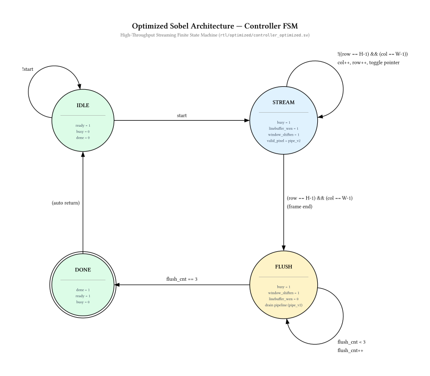

</fig>

<fig id="fig-optimized-datapath" caption="شماتیک کامل مدار سخت‌افزاری معماری بهینه‌شده جریانی">

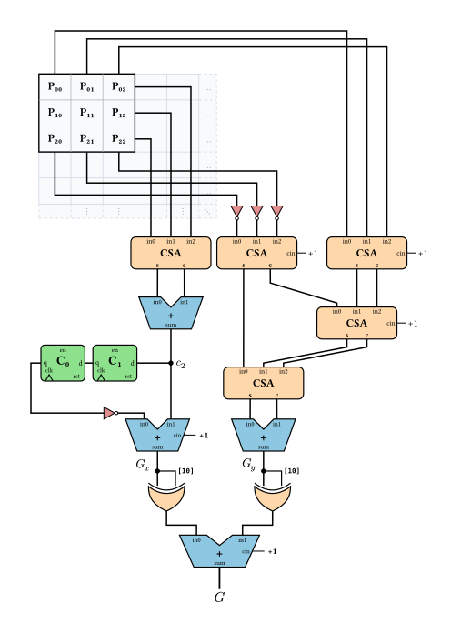

</fig>


## 2-3- معماری پایپ‌لاین ۳ مرحله‌ای (<en>3-Stage</en> Pipeline) {#sec-pipeline-arch}

به منظور ارتقای حداکثر فرکانس و حذف بار ترکیبی زنجیره CSA تا جمع‌کننده اشباع نهایی، معماری پایپ‌لاین ۳ مرحله‌ای طراحی گردید:
- **مرحله ۱:** دریافت پیکسل‌ها، محاسبه مجموع ستونی $c_2$ با CSA و محاسبه مؤلفه‌های مثبت و منفی $G_y$. ثبت خروجی‌ها در ثبات‌های پایپ‌لاین مرحله اول.
- **مرحله ۲:** محاسبه کامل گرادیان‌های علامت‌دار $G_x$ و $G_y$ و اعمال گیت‌های وارون‌ساز قدرمطلق. ثبت در ثبات‌های پایپ‌لاین مرحله دوم.
- **مرحله ۳:** جمع قدرمطلق‌ها، اعمال برش اشباع به دامنه ۸ بیتی و تولید سیگنال خروجی `pixel_out`.

---

# 3- شبیه‌سازی {#sec-sim-opencv}

پس از اجرای موفق تست‌بنچ و تولید فایل `image_out.hex`، اسکریپت `Checker.py` جهت مقایسه خروجی سخت‌افزار با مدل مرجع OpenCV اجرا شد.

<v space="1.5cm" />


<fig id="fig-opencv-comparison" caption="نمونه ۱">


|  |  |
| :-----------------------------------------------: | :------------------------------------------------: |
|    **تصویر ورودی خاکستری ($640 \times 853$)**     |           **خروجی فیلتر سوبل**            |

</fig>

<v space="1.5cm" />


برای ارزیابی عملکرد مدار سخت‌افزاری، یک **مجموعه تصویر آزمون** بر روی تمامی **سه معماری سخت‌افزاری** (پایه، بهینه‌شده جریانی و پایپ‌لاین ۳ مرحله‌ای) به طور مجزا شبیه‌سازی شدند ($۱۵$ اجرای شبیه‌سازی کامل با مدل RTL و قیدهای SVA). سپس خروجی هر معماری هم در کل فریم (با رفتار حاشیه Zero-Padding مطابق ساختار `Checker.py`) و هم در ناحیه فعال و معتبر فیلتر ($638 \times 851$) با مدل مرجع OpenCV مقایسه و محاسبه گردید.

<breakpage />


نتایج کامل ارزیابی عددی و تفکیکی میان کل فریم و ناحیه فعال پردازش در جدول زیر درج گردیده است:

<v space="1.5cm" />

#### جدول ۱-۳: ارزیابی خطای تصویر ورودی ۱ (input1)

| معماری سخت‌افزاری | خروجی رسمی خطای کل فریم (Checker.py) | بیشینه خطای کل فریم | میانگین خطای ناحیه فعال | بیشینه خطای ناحیه فعال |
| :---: | :---: | :---: | :---: | :---: |
| **Baseline** | **۰.۱۰** (۰.۱۰۴۶) | ۲۵۵ | **۰.۰۰۰۰** | ۰ |
| **Optimized** | **۰.۲۲** (۰.۲۱۹۶) | ۲۵۵ | **۰.۱۱۵۶** | ۵۲ |
| **Pipeline** | **۰.۲۲** (۰.۲۱۹۶) | ۲۵۵ | **۰.۱۱۵۶** | ۵۲ |

<v space="1.5cm" />

#### جدول ۲-۳: ارزیابی خطای تصویر ورودی ۲ (input2)

| معماری سخت‌افزاری | خروجی رسمی خطای کل فریم (Checker.py) | بیشینه خطای کل فریم | میانگین خطای ناحیه فعال | بیشینه خطای ناحیه فعال |
| :---: | :---: | :---: | :---: | :---: |
| **Baseline** | **۰.۲۳** (۰.۲۲۹۶) | ۲۵۵ | **۰.۰۰۰۰** | ۰ |
| **Optimized** | **۰.۳۵** (۰.۳۴۷۶) | ۲۵۵ | **۰.۱۱۸۶** | ۱۶۷ |
| **Pipeline** | **۰.۳۵** (۰.۳۴۷۶) | ۲۵۵ | **۰.۱۱۸۶** | ۱۶۷ |

<v space="1.5cm" />

#### جدول ۳-۳: ارزیابی خطای تصویر ورودی ۳ (input3)

| معماری سخت‌افزاری | خروجی رسمی خطای کل فریم (Checker.py) | بیشینه خطای کل فریم | میانگین خطای ناحیه فعال | بیشینه خطای ناحیه فعال |
| :---: | :---: | :---: | :---: | :---: |
| **Baseline** | **۰.۰۲** (۰.۰۱۶۳) | ۲۵۵ | **۰.۰۰۰۰** | ۰ |
| **Optimized** | **۰.۰۲** (۰.۰۱۶۴) | ۲۵۵ | **۰.۰۰۰۱** | ۶ |
| **Pipeline** | **۰.۰۲** (۰.۰۱۶۴) | ۲۵۵ | **۰.۰۰۰۱** | ۶ |


<v space="1.5cm" />

#### جدول ۴-۳: ارزیابی خطای تصویر ورودی ۴ (input4)

| معماری سخت‌افزاری | خروجی رسمی خطای کل فریم (Checker.py) | بیشینه خطای کل فریم | میانگین خطای ناحیه فعال | بیشینه خطای ناحیه فعال |
| :---: | :---: | :---: | :---: | :---: |
| **Baseline** | **۰.۰۰** (۰.۰۰۰۰) | ۰ | **۰.۰۰۰۰** | ۰ |
| **Optimized** | **۰.۰۰** (۰.۰۰۲۰) | ۱ | **۰.۰۰۲۰** | ۱ |
| **Pipeline** | **۰.۰۰** (۰.۰۰۲۰) | ۱ | **۰.۰۰۲۰** | ۱ |

<v space="1.5cm" />

#### جدول ۵-۳: ارزیابی خطای تصویر ورودی ۵ (input5)

| معماری سخت‌افزاری | خروجی رسمی خطای کل فریم (Checker.py) | بیشینه خطای کل فریم | میانگین خطای ناحیه فعال | بیشینه خطای ناحیه فعال |
| :---: | :---: | :---: | :---: | :---: |
| **Baseline** | **۰.۰۱** (۰.۰۱۴۴) | ۲۵۵ | **۰.۰۰۰۰** | ۰ |
| **Optimized** | **۰.۰۲** (۰.۰۲۲۳) | ۲۵۵ | **۰.۰۰۷۹** | ۵۶ |
| **Pipeline** | **۰.۰۲** (۰.۰۲۲۳) | ۲۵۵ | **۰.۰۰۷۹** | ۵۶ |


<fig id="fig-sample-input2" caption="نمونه ۲">

|  | 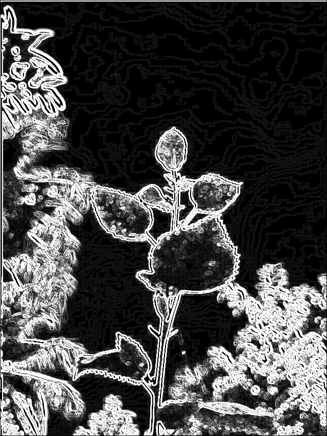 |
| :-----------------------------------------------: | :------------------------------------------------: |
|    **تصویر ورودی خاکستری ($640 \times 853$)**     |           **خروجی فیلتر سوبل سخت‌افزار**            |

</fig>

<fig id="fig-sample-input3" caption="نمونه ۳">

| 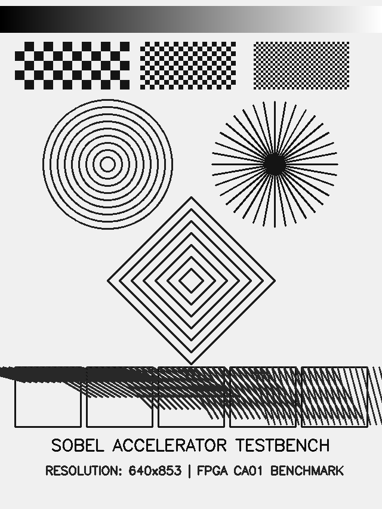 | 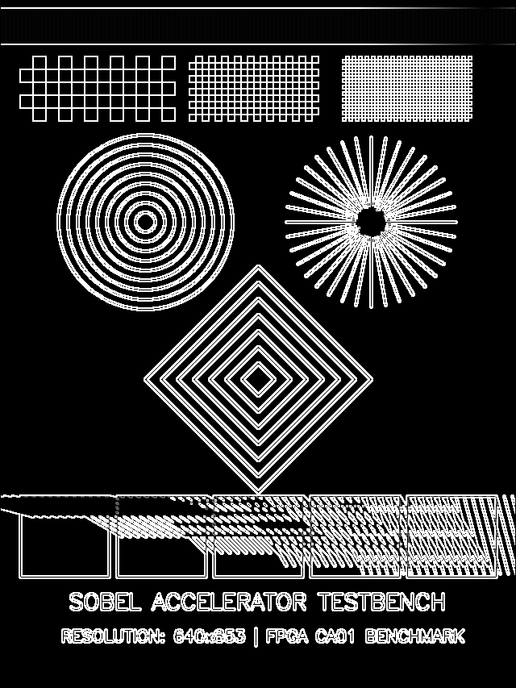 |
| :-----------------------------------------------: | :------------------------------------------------: |
|    **تصویر ورودی خاکستری ($640 \times 853$)**     |           **خروجی فیلتر سوبل سخت‌افزار**            |

</fig>

<fig id="fig-sample-input4" caption="نمونه ۴">

| 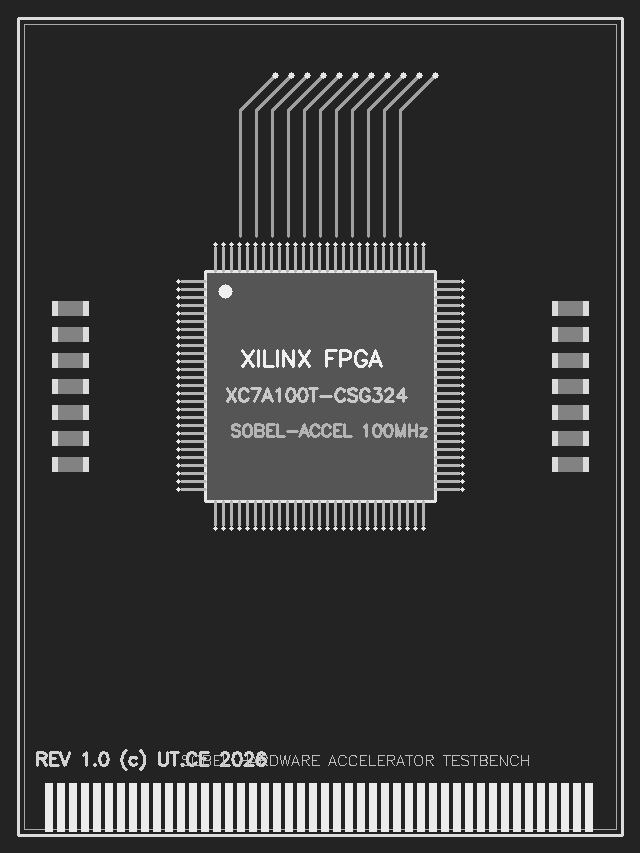 | 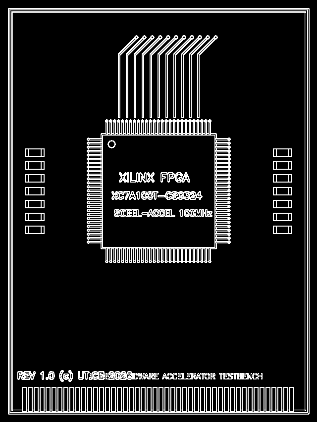 |
| :-----------------------------------------------: | :------------------------------------------------: |
|    **تصویر ورودی خاکستری ($640 \times 853$)**     |           **خروجی فیلتر سوبل سخت‌افزار**            |

</fig>

<fig id="fig-sample-input5" caption="نمونه ">

|  | 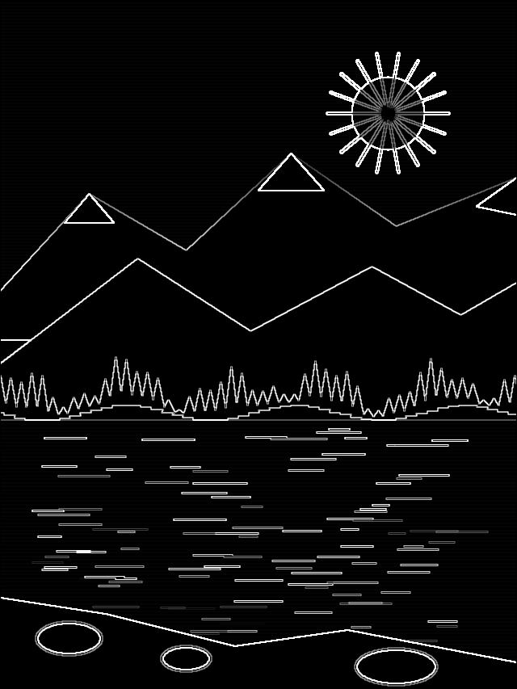 |
| :-----------------------------------------------: | :------------------------------------------------: |
|    **تصویر ورودی خاکستری ($640 \times 853$)**     |           **خروجی فیلتر سوبل سخت‌افزار**            |

</fig>

<v space="1cm" />

| معماری سخت‌افزاری                  | تعداد سیکل کلاک | زمان اجرای کل (ms) | نرخ گذردهی پیکسل | نرخ فریم (FPS) | ضریب شتاب (Speedup) |
| :-------------------------------- | :-------------: | :----------------: | :--------------: | :------------: | :-----------------: |
| **Baseline**        |    ۳,۰۴۰,۰۷۸    |     ۳۰.۴۰۱ ms      |   ۱۷.۸۶ Mpx/s    |     ۳۲.۸۹      |    ۱.۰۰x (مرجع)     |
| **Optimized**  |   **۵۴۵,۹۲۶**   |    **۵.۴۵۹ ms**    | **۹۹.۴۵ Mpx/s**  |   **۱۸۳.۱۸**   |      **۵.۵۷x**      |
| **Pipeline** |   **۵۴۵,۹۲۹**   |    **۵.۴۵۹ ms**    | **۹۹.۴۵ Mpx/s**  |   **۱۸۳.۱۷**   |      **۵.۵۷x**      |

<v space="0.5cm" />


معماری پایه برای محاسبه هر پیکسل به ۴ الی ۵ سیکل نیاز داشت و کل تصویر را در ۳,۰۴۰,۰۷۸ سیکل تمام می‌کرد. در معماری جریانی بهینه، با آغاز تولید خروجی از سیکل ۱۲۸۴، در هر سیکل کلاک دقیقاً یک پیکسل تولید می‌شود و پردازش تصویر در ۵۴۵,۹۲۶ سیکل پایان می‌پذیرد که به معنای شتاب ۵.۵۷ برابری است.

در فرکانس پایه ۱۰۰ مگاهرتز، سیستم قادر است بیش از **۱۸۳ فریم بر ثانیه** را پردازش کند. در صورت بهره‌برداری در حداکثر فرکانس کاری تراشه ($F_{\max} = 212.86\text{ MHz}$)، این گذردهی به رقمی بیش از **۳۸۰ فریم بر ثانیه** افزایش پیدا کند.

<pagebreak>

# 4- درستی‌سنجی با SystemVerilog Assertions (SVA) {#sec-sva-results}

<v space="0.2cm" />

برای درستی‌سنجی با استفاده از SVA یک پوشه به اسم `sva` ساخته شد که دوگان تمام ماژول‌هایی که نیاز به SVA داشتن را قرار دادیم.
برای verify کردن‌های آنی از Immediate SVA استفاده شده و برای پروتکل‌ها و توابع وابسته به زبان از Concurrent SVA استفاده شده.


<v space="0.1cm" />

## 4-1- بخشی از انواع سناریو‌های پوشش داده شده

<v space="0.5cm" />

### ۱. وضعیت خروجی در هنگام ریست (Reset State Verification)
بررسی اینکه به محض فعال شدن سیگنال ریست ناهمگام، کلیه سیگنال‌های کنترلی خروجی در وضعیت غیرفعال قرار گرفته و سیگنال `ready` فعال باشد:

```systemverilog
CTRL_SIG_RESET: assert property (@(posedge clk) rst |-> 
    (!valid_pixel && !busy && !done && ready))
else $error("[SVA] Control signals not in IDLE state during reset!");
```

<v space="0.5cm" />

### ۲. معتبر بودن خروجی و عدم وجود مقادیر نامعین (Output Validity)
بررسی اینکه خروجی `pixel_out` تنها در زمان فعال بودن `valid_pixel` دارای اعتبار است و هیچ‌یک از سیگنال‌های کنترلی در طول کار مدار مقدار نامعین ($X$ یا $Z$) به خود نمی‌گیرند:

```systemverilog
VALID_PIXEL_KNOWN: assert property (@(posedge clk) disable iff (rst)
    valid_pixel |-> !$isunknown(pixel_out))
else $error("[SVA] valid_pixel is high but pixel_out is X or Z!");

VALID_IMPLIES_BUSY: assert property (@(posedge clk) disable iff (rst)
    valid_pixel |-> busy)
else $error("[SVA] valid_pixel asserted while controller is not busy!");
```

<v space="0.5cm" />

### ۳. تأخیر دقیق زمانی مسیر داده (Datapath Latency Assertion)
در معماری بهینه، تولید اولین پیکسل معتبر مستلزم پر شدن ۲ سطر اولیه بافر سطری (معادل $2 \times 640$ پیکسل) به اضافه ۴ سیکل راه‌اندازی پنجره لغزان است. قید زمانی زیر تطابق دقیق این تأخیر ($1284$ سیکل) را می‌سنجد:

```systemverilog
localparam int EXPECTED_LATENCY = (2 * WIDTH_SIZE) + 4; // 1284 cycles

CORRECT_VALID_ISSUE: assert property (@(posedge clk) disable iff (rst)
    (ready && start) |-> ##(EXPECTED_LATENCY + 1) valid_pixel)
else $error("[SVA] valid_pixel did not assert at the expected cycle!");
```

<v space="0.5cm" />

### ۴. محدوده دینامیکی و عملکرد اشباع (Dynamic Range & Saturation Clamping)
اطمینان از اینکه مقدار خروجی نهایی هرگز از ۲۵۵ تجاوز نکرده و در صورتی که گرادیان محاسبه‌شده از ۲۵۵ بزرگتر شود، حتماً مقدار خروجی به ۲۵۵ برش خورده باشد:

```systemverilog
G_SAT_BOUND: assert property (@(posedge clk) disable iff (rst)
    int'(G_sat) >= 0 && int'(G_sat) <= 255)
else $error("[SVA] G_sat output exceeds 8-bit bounds [0, 255]!");

SATURATION_CLAMP: assert property (@(posedge clk) disable iff (rst)
    (G < 11'd256) || (G_sat == 8'd255))
else $error("[SVA] Saturation failure! Gradient G=%0d exceeded 255 but G_sat was not clamped to 255 (got %0d)", G, G_sat);
```

<v space="0.5cm" />

### ۵. رفتار سیگنال‌های کنترلی و انحصار متقابل (Protocol Consistency)
بررسی عدم تداخل رفتاری سیگنال‌های وضعیت، شامل انحصار متقابل میان `ready` و `busy`، انتقال صحیح به حالت اشتغال پس از دریافت `start` و بازگشت به حالت آماده‌باش پس از پایان پردازش:

```systemverilog
MUTUAL_EXCL: assert property (@(posedge clk) disable iff (rst)
    !(ready && busy))
else $error("[SVA] Controller cannot be both ready and busy!");

START_TO_STREAM: assert property (@(posedge clk) disable iff (rst)
    (ready && start) |=> (busy && !ready))
else $error("[SVA] start asserted while ready did not transition to busy!");

DONE_TO_IDLE: assert property (@(posedge clk) disable iff (rst)
    done |=> (ready && !busy))
else $error("[SVA] done asserted did not return to ready next cycle!");
```


**نتیجه شبیه‌سازی در حالت صحیح (Clean Golden Run)**

شبیه‌سازی کامل مدار با فعال بودن تمامی قیدهای SVA بر روی تصویر ۵۴۵,۹۲۰ پیکسلی اجرا شد. لاگ استخراج‌شده از شبیه‌ساز در فایل `sim/assertion_bug_logs/golden_clean.log` نشان می‌دهد که حتی یک مورد نقض قید زمانی گزارش نشده است:

```text
==================================================================
   Sobel Optimized Accelerator Testbench with SVA Verification   
   Image Dimensions: 640 x 853 | Total Pixels: 545920
==================================================================
[INFO] Loading input image hex from: inputs/input1/image_in.hex ...
[INFO] Successfully loaded 545920 input pixels.
[Time 12905000 ns] First valid pixel detected!
[Time 12915000 ns] [OPTIMIZED] Valid Pixel #1 = 0x00 (0)
[SVA controller_optimized] Measured latency from start to first valid_pixel: 1284 cycles (Expected: 1284)
...
[Time 5459305000 ns] DUT asserted DONE interrupt!
------------------------------------------------------------------
Optimized Simulation Complete:
  Total Input Pixels Fed     : 545920 / 545920
  Total Valid Pixels Produced: 542938 / 542938
------------------------------------------------------------------
Saved optimized hex output to sim/image_out_optimized.hex
- S i m u l a t i o n   R e p o r t: Verilator 5.050 / QuestaSim
- Status: PASSED (Zero Assertion Violations)
```

---

<pagebreak>

## 4-2 بخش امتیازی: سناریوهای تزریق تعمدی خطا (Bug Injections) {#sec-bug-injections}

<v space="0.5cm" />

برای اثبات و نمایش کارایی SVAهای نوشته شده، پنج نقص سخت‌افزاری تعمدی در کدهای کنترلر و مسیر داده در پوشه `rtl/bugged_optimized/` قرار داده شد و شبیه‌سازی برای هر سناریو به صورت مجزا اجرا شد. خروجی‌ها نشان می‌دهد که SVA در همان سیکل بروز خطا، شبیه‌سازی را متوقف کرده و Error نوشته شده است:

| شناسه خطا | عنوان سناریوی نقص تزریق‌شده                          | ماژول تغییریافته          | پیام خطای استخراج‌شده از لاگ شبیه‌سازی (`sim/assertion_bug_logs/`)                                                                                                                          |
| :-------: | :-------------------------------------------------- | :------------------------ | :---------------------------------------------------------------------------------------------------------------------------------------------------------------------------------------- |
| <en>**Bug 1**</en> | فعال ماندن سیگنال‌های کنترلی در زمان ریست            | `controller_optimized.sv` | `%Error: controller_optimized_sva.sv:74: Assertion failed in a_reset_state: [SVA controller_optimized] Signals not idle during reset!`                                                    |
| <en>**Bug 2**</en> | دستکاری شمارنده تأخیر راه‌اندازی پنجره               | `controller_optimized.sv` | `%Error: controller_optimized_sva.sv:106: Assertion failed in a_datapath_latency: [SVA controller_optimized] Datapath latency mismatch! Expected 1284 cycles, got 644`                    |
| <en>**Bug 3**</en> | عدم تغییر وضعیت مدار به Busy پس از پالس Start       | `controller_optimized.sv` | `%Error: controller_optimized_sva.sv:82: Assertion failed in a_start_to_busy: [SVA controller_optimized] start asserted while ready did not transition to busy!`                          |
| <en>**Bug 4**</en> | اعلام زودهنگام معتبر بودن پیکسل بدون آماده‌بودن بافر | `controller_optimized.sv` | `%Error: controller_optimized_sva.sv:106: Assertion failed in a_datapath_latency: [SVA controller_optimized] Datapath latency mismatch! Expected 1284 cycles, got 0`                      |
| <en>**Bug 5**</en> | حذف منطق اشباع و سرریز مقادیر گرادیان بالای ۲۵۵     | `core_optimized.sv`       | `%Error: core_optimized_sva.sv:31: Assertion failed in SATURATION_CLAMP: [SVA core_optimized] Saturation failure! Gradient G=450 exceeded 255 but G_sat was not clamped to 255 (got 194)` |

<pagebreak>

# 5- نتایج سنتز و پیاده‌سازی در Vivado {#sec-vivado-results}

<v space="0.5cm" />


تمامی فایل‌های طراحی <en>SystemVerilog</en> برای تراشه <en>xc7z020clg400-1 (Xilinx Zynq-7020)</en> زیر سنتز و پیاده‌سازی شدند (در محیط نرم‌افزار <en>**Vivado 2022.2**</en>).


## 5-1- پیاده‌سازی بدون محدودیت کلاک (Unconstrained Implementation) {#sec-unconstrained-analysis}

پیاده‌سازی مدار در نرم‌افزار Vivado در دو فاز اساسی انجام گرفت: ابتدا اجرای پیاده‌سازی فیزیکی **پیش از تعریف قید کلاک** جهت مشاهده و ثبت رفتارهای ذاتی مدار و هشدارهای ابزار، و سپس **اعمال فایل قیود XDC با کلاک ۱۰۰ مگاهرتز** برای بهینه‌سازی دقیق زمان‌بندی و توان مصرفی.

<v space="0.4cm" />

### الف) پیامدهای عدم تعریف محدودیت کلاک و غیاب استنتاج BRAM

<v space="0.2cm" />

۱. **وضعیت زمان‌بندی نامعین:** در غیاب دستور قید کلاک، ابزار Vivado هیچ فرکانس کاری مشخصی برای طراحی متصور نبوده و پیام هشدار زیر در خلاصه زمان‌بندی درج گردید:
```text
There are no user specified timing constraints.
```
در این حالت، مقادیر WNS، TNS و حاشیه زمانی با `NA` یا `inf` مقداردهی می‌شوند و ابزار قادر به اعتبارسنجی پایداری setup یا hold نیست.

۲. **انفجار توان مصرفی (۱۷۶.۱۷۴ وات) و نقض محدوده دمایی:** موتور شبیه‌سازی توان Vivado در حالت بدون قید کلاک، بر اساس نرخ کلیدزنی فرضی بسیار شدید عمل می‌کند. در نتیجه، توان مصرفی روی تراشه به رقم بحرانی **۱۷۶.۱۷۴ وات** صعود کرد و سیستم پیام خطای قرمز رنگ زیر را صادر نمود:
```text
Junction temp exceeded!
```

۳. **سنتز اولیه بافر سطری بر روی منطق توزیع‌شده (Distributed Logic):** به دلیل سبک توصیف اولیه آرایه‌های حافظه، بافر سطری نتوانست به بلوک‌های سخت‌افزاری BRAM مپ شود و به ناچار به صورت شیفت رجیسترهای توزیع‌شده بر روی اسلایس‌ها پیاده گردید. این امر به تنهایی منجر به مصرف سرسام‌آور **۶,۴۰۲ اسلایس LUT** (۱۲.۰۳٪ تراشه) و **۱۵,۵۱۱ رجیستر FF** (۱۴.۵۸٪ تراشه) شد.

<v space="0.4cm" />

### ب) مرحله میانی: بازنویسی و استنتاج حافظه بلوکی (BRAM Inference)
پیش از اعمال قید کلاک، کدهای ذخیره‌سازی داده‌های سطری اصلاح شدند تا ساختار سخت‌افزاری تراشه Zynq به طور خودکار بلوک‌های `RAMB18E1` را استنتاج کند:
- منابع مصرفی مدار به طرز چشمگیری افت کرد: مصرف اسلایس‌های LUT از ۶,۴۰۲ عدد به **۱۴۹ عدد (۰.۲۸٪)** و تعداد فلیپ‌فلاپ‌ها از ۱۵,۵۱۱ عدد به **۱۲۷ عدد (۰.۱۲٪)** تقلیل یافت و بافرها درون **۳ بلوک RAMB18E1 (۱.۵ تایل)** جای گرفتند.
- توان کل تخمینی بدون کلاک نیز از ۱۷۶.۱۷۴ وات به **۸.۱۰۰ وات** (بیش از ۹۵٪ کاهش توان) محدود گردید.

<v space="0.2cm" />


## 5-2- اعمال محدودیت کلاک و بهینه‌سازی زمان‌بندی (Constrained Implementation) {#sec-constrained-analysis}

برای سنجش  زمان‌بندی و پایداری عملکرد مدار در فرکانس ۱۰۰ مگاهرتز (پریود ۱۰ نانوثانیه)، قید زمانی کلاک در فایل `pin_assignment.xdc` تعریف گردید:

```tcl
create_clock -period 10.000 -name CLK_100MHz [get_ports clk]
```

پس از اعمال این قید و اجرای مجدد فرآیندهای Synthesis و Implementation:

۱. تمامی مسیرهای زمانی درون‌کلاکی به دقت تحلیل شدند و حاشیه امن زمانی setup **WNS = +3.299 ns** حاصل گردید که بدون نقص قیود زمانی است (TNS = 0.00 ns).

۲. برآورد توان بر مبنای فرکانس کاری واقعی ۱۰۰ مگاهرتز انجام شد و توان کل روی تراشه به مقدار بسیار ایده‌آل **۰.۱۱۷ وات (۱۱۷ میلی‌وات)** شد.

۳. دمای پیوند تراشه در دمای محیط ۲۵ درجه سلسیوس در سطح خنک **۲۶.۳ درجه سلسیوس** ثبت شد و حاشیه حرارتی مثبت **+۵۸.۷ درجه سلسیوس** ثبت شد.

<breakpage />

### جدول ۱-۵: مقایسه تحلیلی مراحل سه‌گانه تکامل سنتز و پیاده‌سازی معماری پایه

| شاخص و پارامتر ارزیابی | مرحله ۱: پیاده‌سازی اولیه (بدون کلاک، بدون BRAM) | مرحله ۲: استنتاج BRAM (بدون کلاک، با BRAM) | مرحله ۳: پیاده‌سازی نهایی (با کلاک ۱۰۰MHz و BRAM) |
| :--- | :---: | :---: | :---: |
| **حاشیه امن setup (WNS)** | `NA` (نامعین / inf) | `NA` (نامعین / inf) | **+۳.۲۹۹ ns** |
| **توان کل (Total Power)** | **۱۷۶.۱۷۴ وات** | **۸.۱۰۰ وات** | **۰.۱۱۷ وات (۱۱۷ mW)**|
| **توان دینامیک (Dynamic Power)** | ۱۷۵.۱۳۵ وات (۹۹.۴٪) | ۷.۲۶۳ وات (۸۹.۷٪) | **۰.۰۱۲ وات (۱۲ mW)** |
| **توان استاتیک (Device Static)** | ۱.۰۳۹ وات | ۰.۸۳۷ وات | **۰.۱۰۵ وات (۱۰۵ mW)** |
| **دمای پیوند (Junction Temperature)** | **۱۲۵.۰ °C** | **۱۱۸.۴ °C** | **۲۶.۳ °C** |
| **حاشیه امن حرارتی (Thermal Margin)** | **-۱۹۷۱.۸ °C** | **-۳۳.۴ °C** | **+۵۸.۷ °C** |
| **تعداد اسلایس‌های LUT** | **۶,۴۰۲** (۱۲.۰۳٪) | **۱۴۹** (۰.۲۸٪) | **۱۴۸** (۰.۲۸٪) |
| **تعداد رجیسترهای Slice (FF)** | **۱۵,۵۱۱** (۱۴.۵۸٪) | **۱۲۷** (۰.۱۲٪) | **۱۲۷** (۰.۱۲٪) |
| **بلوک‌های Block RAM <en>(RAMB18)</en>** | **۰** | **۳** (۱.۵ تایل - ۱.۰۷٪) | **۳** (۱.۵ تایل - ۱.۰۷٪) |


<v space="0.5cm" />

### جدول 2-5: مصرف منابع سخت‌افزاری در حالت مقید نهایی

| منبع سخت‌افزاری | ظرفیت تراشه Zynq-7020 | معماری پایه (Baseline) | معماری بهینه‌شده (Optimized) | معماری پایپ‌لاین (Pipeline) |
| :--- | :---: | :---: | :---: | :---: |
| **Slice LUTs** | ۵۳,۲۰۰ | ۱۴۸ (۰.۲۸٪) | ۱۲۱ (۰.۲۳٪) | ۱۱۷ (۰.۲۲٪) |
| **Slice Registers (FF)** | ۱۰۶,۴۰۰ | ۱۲۷ (۰.۱۲٪) | ۱۱۵ (۰.۱۱٪) | ۱۷۸ (۰.۱۷٪) |
| **Block RAM (RAMB18)** | ۲۸۰ (۱۴۰ تایل) | ۳ (۱.۵ تایل - ۱.۰۷٪) | ۲ (۱.۰ تایل - ۰.۷۱٪) | ۲ (۱.۰ تایل - ۰.۷۱٪) |
| **Bonded IOB** | ۱۲۵ | ۲۶ (۲۰.۸۰٪) | ۲۳ (۱۸.۴۰٪) | ۲۳ (۱۸.۴۰٪) |
| **Clock Buffer (BUFG)** | ۳۲ | ۱ (۳.۱۳٪) | ۱ (۳.۱۳٪) | ۱ (۳.۱۳٪) |


<v space="0.5cm" />

<mybox type="success">

۱- معماری بهینه‌شده مصرف اسلایس‌های LUT را از ۱۴۸ به ۱۲۱ عدد (۱۸.۲٪ کاهش) و تعداد فلیپ‌فلاپ‌ها را از ۱۲۷ به ۱۱۵ عدد (۹.۴٪ کاهش) ; کاهش داده است.

۲- با حذف سطر سوم بافر سطری مصرف حافظه BRAM به میزان ۳۳.۳٪ بهینه‌سازی شده و از ۳ بلوک به ۲ بلوک کاهش یافته است.

۳- در معماری پایپ‌لاین، تعداد رجیسترها به دلیل افزودن ثبات‌های بین‌مرحله‌ای جهت افزایش سرعت کلاک به ۱۷۸ عدد افزایش یافته است.

</mybox>

<breakpage />

## 5-4- تحلیل زمان‌بندی و محاسبه حداکثر فرکانس کاری ($F_{\max}$) {#sec-timing-results}

<v space="0.2cm" />

گزارش <en>Timing Summary</en> پس از اجرای کامل Routing استخراج گردید. مقادیر <en>WNS</en> (بدترین حاشیه امن زمانی setup) و <en>TNS</en> (مجموع خطاهای setup) وضعیت برقراری کامل قیود زمانی را نشان می‌دهند:

| پارامتر زمانی | معماری پایه (Baseline) | معماری بهینه‌شده (Optimized) | معماری پایپ‌لاین (Pipeline) |
| :--- | :---: | :---: | :---: |
| **دوره کلاک هدف ($T_{\text{clk}}$)** | ۱۰.۰۰ نانوثانیه (۱۰۰ MHz) | ۱۰.۰۰ نانوثانیه (۱۰۰ MHz) | ۱۰.۰۰ نانوثانیه (۱۰۰ MHz) |
| **حاشیه setup (WNS)** | **+۳.۲۹۹ ns** | **+۵.۳۰۲ ns** | **+۵.۱۵۹ ns** |
| **مجموع منفی setup (TNS)** | ۰.۰۰ ns (بدون خطا) | ۰.۰۰ ns (بدون خطا) | ۰.۰۰ ns (بدون خطا) |
| **حاشیه hold (WHS)** | +۰.۰۸۳ ns | +۰.۱۶۶ ns | +۰.۱۴۳ ns |
| **عرض پالس بحرانی (WPWS)** | +۴.۵۰۰ ns | +۴.۵۰۰ ns | +۴.۵۰۰ ns |
| **$T_{\min}$** | **۶.۷۰۱ ns** | **۴.۶۹۸ ns** | **۴.۸۴۱ ns** |
| **$F_{\max}$** | **۱۴۹.۲۳ MHz** | **۲۱۲.۸۶ MHz** | **۲۰۶.۵۷ MHz** |

<v space="0.5cm" />

### نحوه محاسبه ریاضی حداکثر فرکانس کاری ($F_{\max}$)
<v space="0.1cm" />

رابطه کمترین دوره تناوب کاری پایدار مدار به صورت زیر است:

$$
T_{\min} = T_{\text{clk}} - \text{WNS}
\tag{۱۰-۵}
$$

سپس حداکثر فرکانس کاری از معکوس این مقدار حاصل می‌شود:

$$
F_{\max} = \frac{1}{T_{\min}} = \frac{1}{T_{\text{clk}} - \text{WNS}}
\tag{۱۱-۵}
$$

- **برای معماری پایه:**
$$ T_{\min} = 10.000\text{ ns} - 3.299\text{ ns} = 6.701\text{ ns} \implies F_{\max} = \frac{1}{6.701\text{ ns}} \approx 149.23\text{ MHz} $$

- **برای معماری بهینه:**
$$ T_{\min} = 10.000\text{ ns} - 5.302\text{ ns} = 4.698\text{ ns} \implies F_{\max} = \frac{1}{4.698\text{ ns}} \approx \mathbf{212.86\text{ MHz}} $$

- **برای معماری پایپ‌لاین:**
$$ T_{\min} = 10.000\text{ ns} - 5.159\text{ ns} = 4.841\text{ ns} \implies F_{\max} = \frac{1}{4.841\text{ ns}} \approx 206.57\text{ MHz} $$

<v space="0.5cm" />

## 5-5- تحلیل مسیر بحرانی (Critical Path Analysis) {#sec-critical-path}

بررسی دقیق گزارش مسیرهای زمانی در Vivado تفاوت‌های ساختاری دو معماری را به روشنی آشکار می‌سازد:

۱. **مسیر بحرانی معماری پایه:**  
   این مسیر از ثبات وضعیت کنترلر `u_controller/FSM_onehot_current_state_reg[5]` آغاز شده، از منطق بافر پنجره، طبقات درخت جمع‌کننده، مالتی‌پلکسرهای حسابی و زنجیره جمع‌کننده سلب نقلی (<en>CARRY4</en>) عبور کرده و نهایتاً به ثبات وضعیت مقصد `u_controller/FSM_onehot_current_state_reg[6]` می‌رسد.
   - **تعداد سطوح منطقی:** ۷ سطح منطقی ترکیبی (شامل ۳ عدد LUT6، ۱ عدد LUT3، ۱ عدد LUT2 و ۲ بلوک CARRY4).
   - **تأخیر کل مسیر داده:** ۶.۶۷۰ نانوثانیه (۲.۳۹۰ نانوثانیه تأخیر منطقی و ۴.۲۸۰ نانوثانیه تأخیر سیم‌بندی و روتینگ).

<v space="0.5cm" />

۲. **مسیر بحرانی معماری بهینه:**  
   در معماری بهینه‌شده، محاسبات سنگین زنجیره‌ای حذف گردیده و مسیر بحرانی به انتقال سیگنال کنترلر `u_controller/col_reg[1]` به ثبات شمارنده محدود شده است.
   - **تعداد سطوح منطقی:** تنها ۳ سطح (شامل ۲ عدد LUT5 و ۱ عدد LUT6).
   - **تأخیر کل مسیر داده:** ۴.۴۳۹ نانوثانیه (۱.۰۵۰ نانوثانیه منطقی و ۳.۳۸۹ نانوثانیه روتینگ).


<breakpage />

## 5-6- اسکرین‌شات‌های Vivado {#sec-vivado-gallery}

### ۱- پیاده‌سازی اولیه بدون قید کلاک و توان بالای ۱۷۶ وات (فایل‌های 01.png، 02.png و 03.png)

این تصاویر مربوط به مرحله اولیه پیاده‌سازی بدون تعریف قید کلاک و قبل از استنتاج BRAM هستند که منجر به توان فاجعه‌بار ۱۷۶ وات و مصرف ۶,۴۰۲ اسلایس LUT شدند:

<fig id="fig-vivado-base-unconstrained-summary" caption="نمای Project Summary پیاده‌سازی بدون کلاک: توان ۱۷۶.۱۷۴ وات و خطای قرمز Junction temp exceeded (فایل 01.png)">

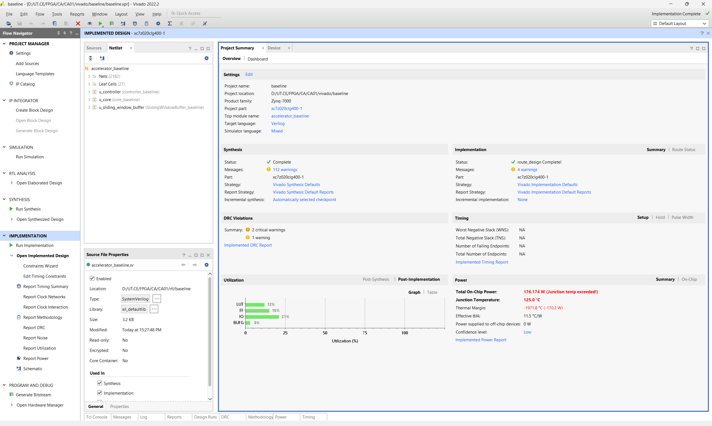

</fig>

<fig id="fig-vivado-base-unconstrained-floorplan" caption="نمای Floorplan تراشه و گزارش Timing بدون قید کلاک با پیام There are no user specified timing constraints (فایل 02.png)">

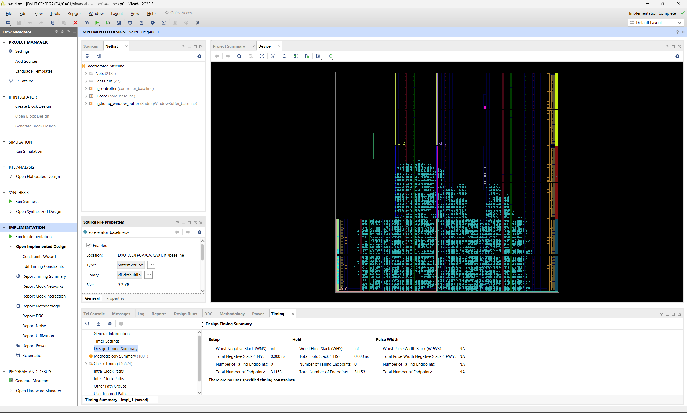

</fig>

<fig id="fig-vivado-base-unconstrained-power" caption="گزارش تفصیلی توان ۱۷۶.۱۷۴ وات و جدول اشغال ۶,۴۰۲ اسلایس LUT و ۱۵,۵۱۱ رجیستر FF در غیاب BRAM (فایل 03.png)">

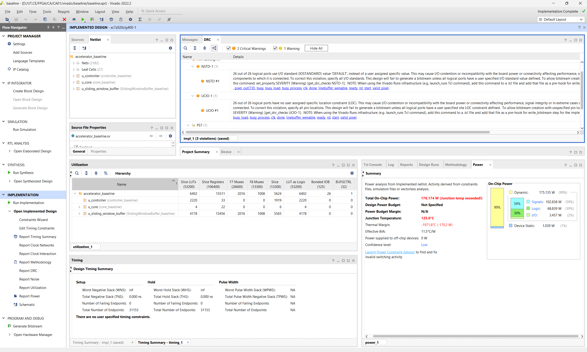

</fig>

### ۲- مرحله میانی: استنتاج BRAM در حالت بدون قید کلاک (فایل‌های دارای پسوند true)

با اصلاح کد توصیف بافر سطری جهت مپ شدن به حافظه سخت‌افزاری `RAMB18E1`، مصرف منابع به ۱۴۹ عدد LUT کاهش یافت و توان مصرفی بدون کلاک با افت ۹۵ درصدی به ۸.۱ وات رسید:

<fig id="fig-vivado-base-true-summary" caption="نمای Project Summary پس از استنتاج BRAM و کاهش توان به ۸.۱ وات در حالت بدون کلاک (فایل 01-true.png)">

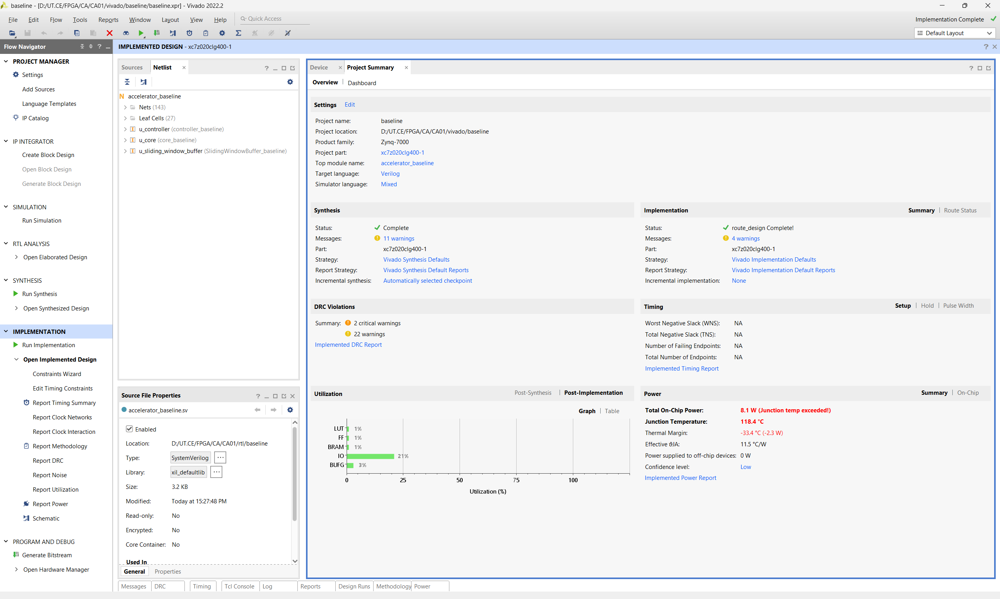

</fig>

<fig id="fig-vivado-base-true-floorplan" caption="نمای Device Floorplan تراشه پس از استنتاج موفق بلوک‌های سخت‌افزاری BRAM (فایل 02-true.png)">

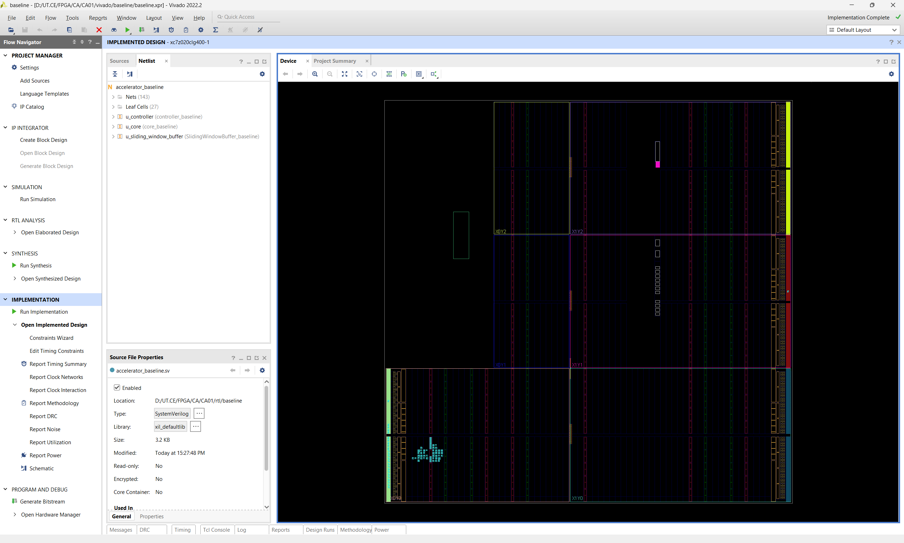

</fig>


<fig id="fig-vivado-base-true-resources" caption="جدول تفصیلی منابع پس از استنتاج BRAM: افت مصرف به ۱۴۹ LUT و ۱۲۷ FF و مپ شدن به ۱.۵ تایل BRAM (فایل 03-true.png)">

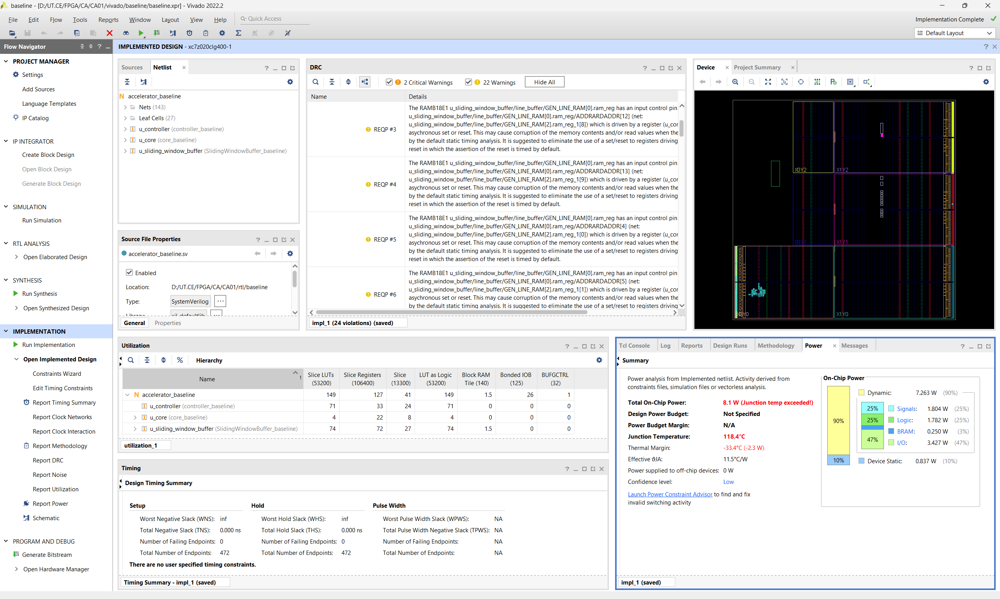

</fig>


### ۳- پیاده‌سازی نهایی مقید با کلاک ۱۰۰ مگاهرتز

پس از تعریف قید کلاک ۱۰ نانوثانیه‌ای در فایل XDC، زمان‌بندی مدار با موفقیت تحلیل شده و توان مدار به ۱۱۷ میلی‌وات و دمای پیوند به ۲۶.۳ درجه سلسیوس تقلیل یافت:

<fig id="fig-vivado-base-overview" caption="نمای کلی خلاصه پیاده‌سازی نهایی معماری پایه با قید کلاک ۱۰۰ مگاهرتز (WNS = +3.299 ns و توان 0.117 W)">

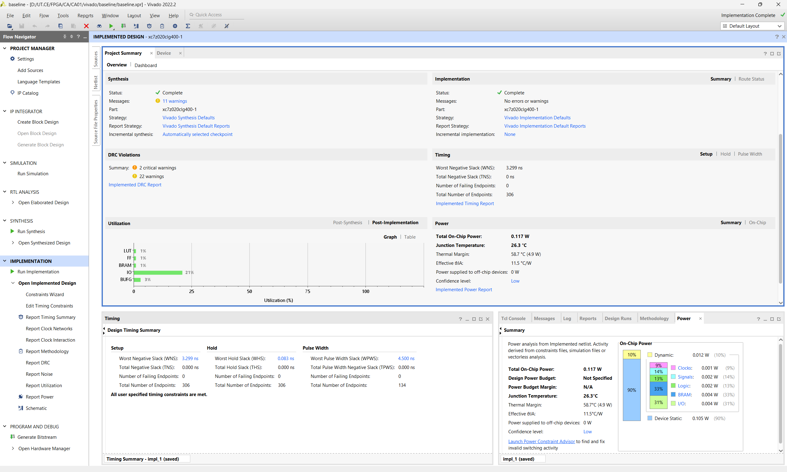

</fig>


<fig id="fig-vivado-base-table" caption="جدول تفصیلی منابع سخت‌افزاری مصرف‌شده نهایی معماری پایه در گزارش Post-Implementation">

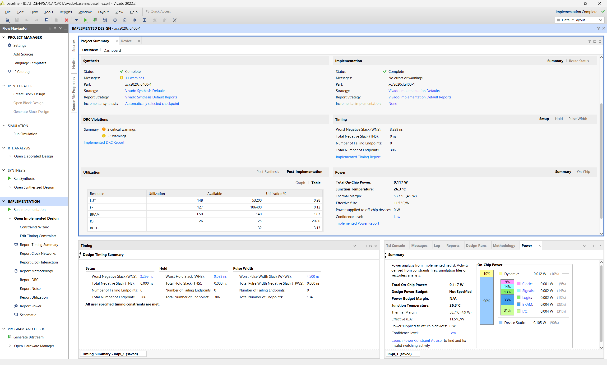

</fig>


<fig id="fig-vivado-base-tcl" caption="محاسبه خودکار حداکثر فرکانس کاری (149.23 MHz) در کنسول Tcl معماری پایه">

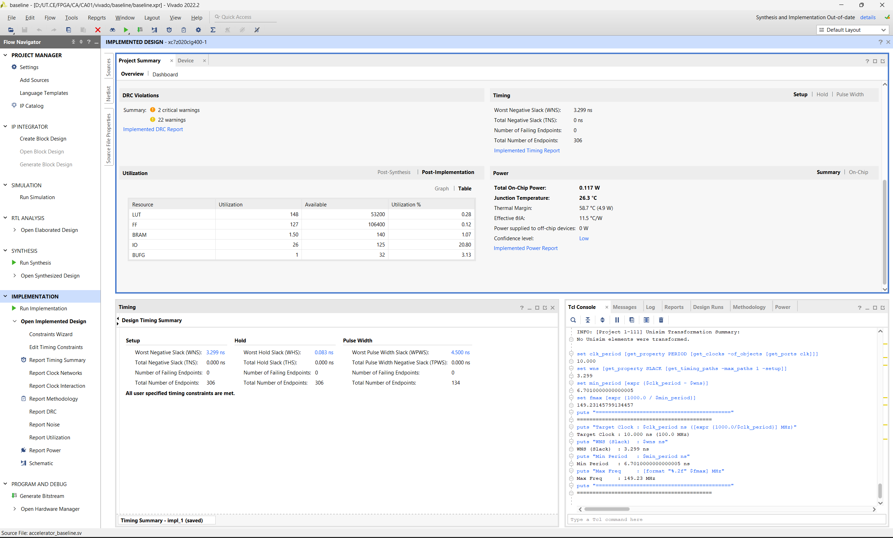

</fig>


<fig id="fig-vivado-base-timing-intra" caption="گزارش تفصیلی مسیرهای زمانی درون‌کلاکی (Intra-Clock Paths) و بررسی حاشیه‌های زمانی">

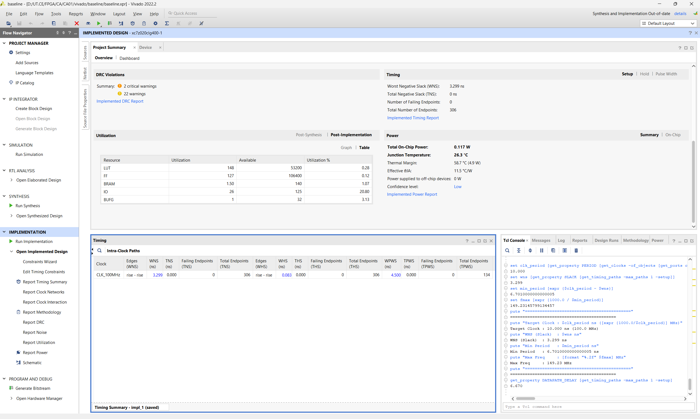

</fig>

<fig id="fig-vivado-base-path" caption="تحلیل اجزای مسیر بحرانی و ۷ سطح منطقی در معماری پایه با تأخیر 6.670 ns">

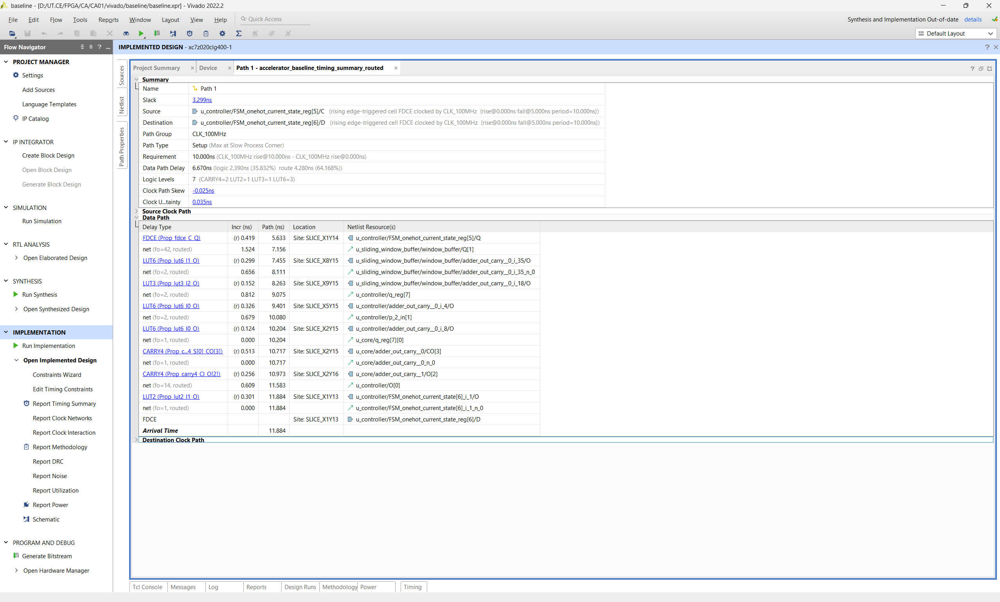

</fig>


### ۴- نتایج پیاده‌سازی معماری بهینه‌شده (Optimized)

<fig id="fig-vivado-opt-overview" caption="نمای کلی خلاصه پروژه معماری بهینه، نمودار توان و حاشیه امن setup (WNS = 5.302 ns)">

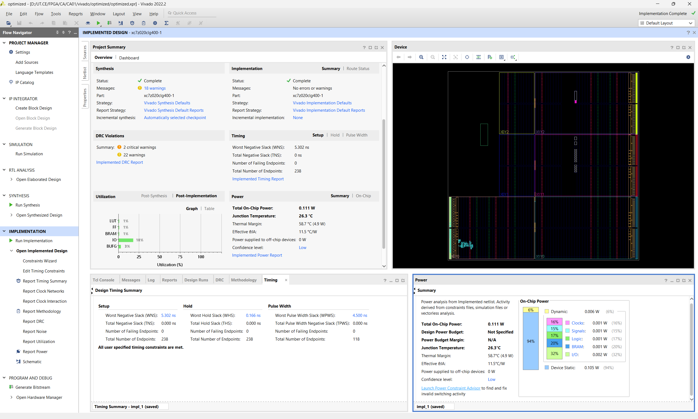

</fig>


<fig id="fig-vivado-opt-table" caption="جدول منابع معماری بهینه نشان‌دهنده کاهش چشمگیر منابع و مصرف تنها ۱ بلوک BRAM">

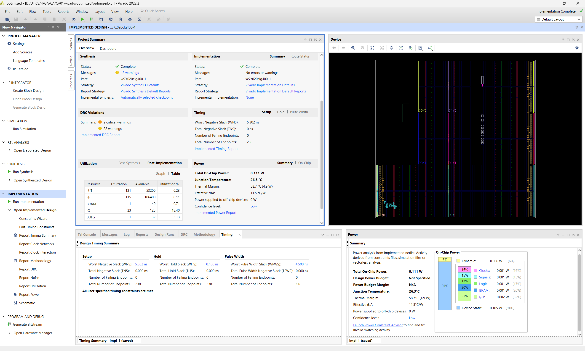

</fig>


<fig id="fig-vivado-opt-tcl" caption="محاسبه حداکثر فرکانس کاری 212.86 MHz در کنسول Tcl برای معماری بهینه‌شده">

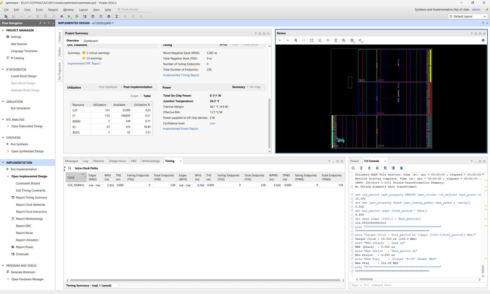

</fig>


<fig id="fig-vivado-opt-path" caption="تحلیل مسیر بحرانی معماری بهینه با کاهش سطوح منطقی به ۳ سطح و تأخیر 4.439 ns">

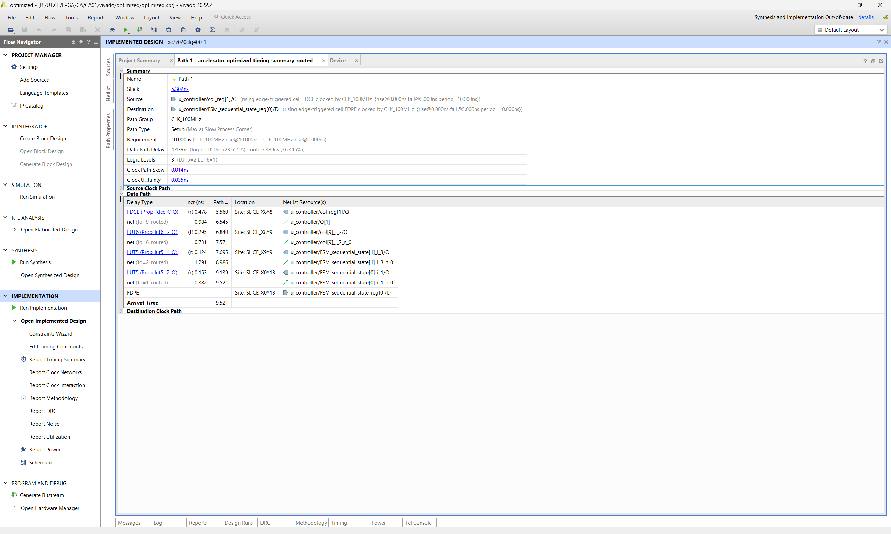

</fig>


### ۵- نتایج پیاده‌سازی معماری پایپ‌لاین و نقشه استقرار فیزیکی (Floorplan)

<fig id="fig-vivado-pipe-overview" caption="خلاصه نتایج پیاده‌سازی معماری پایپ‌لاین ۳ مرحله‌ای (WNS = 5.159 ns)">

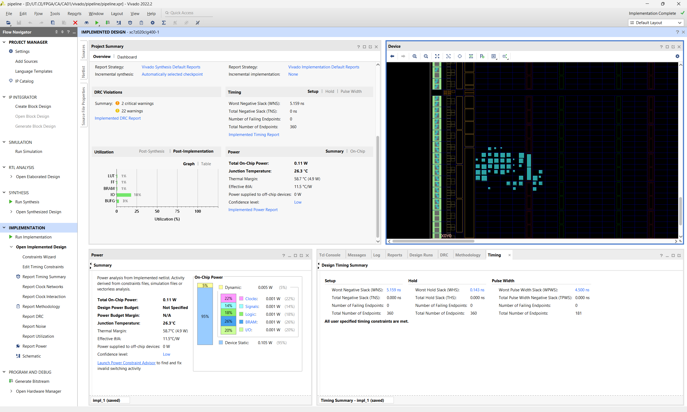

</fig>


<fig id="fig-vivado-pipe-floorplan" caption="نمای زوم‌شده ساختار فیزیکی تراشه (Device Floorplan) نشان‌دهنده تخصیص اسلایس‌ها و سلول‌های حافظه BRAM">

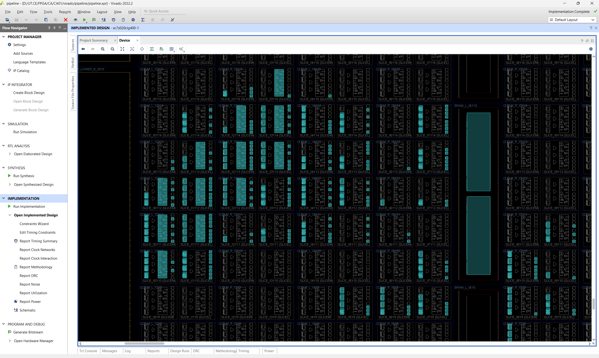

</fig>


<fig id="fig-vivado-pipe-timing" caption="تحلیل زمان‌بندی درون کلاکی (Intra-Clock Paths) برای معماری پایپ‌لاین">

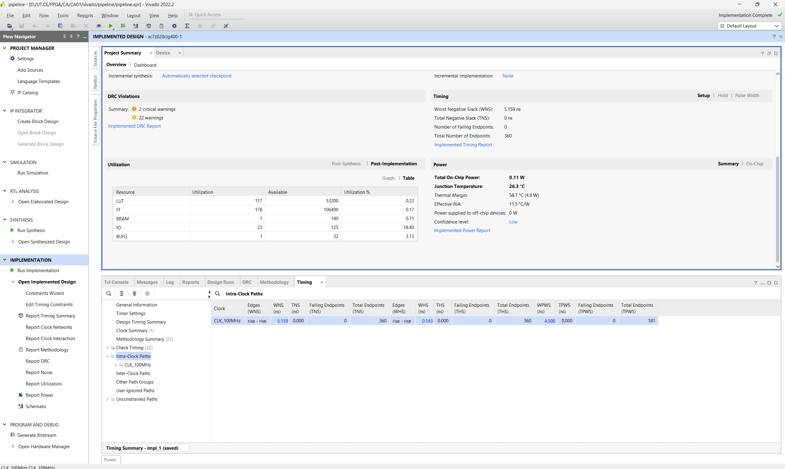

</fig>


<fig id="fig-vivado-pipe-path" caption="گزارش مسیر بحرانی و محاسبه فرکانس کاری 206.57 MHz در معماری پایپ‌لاین">

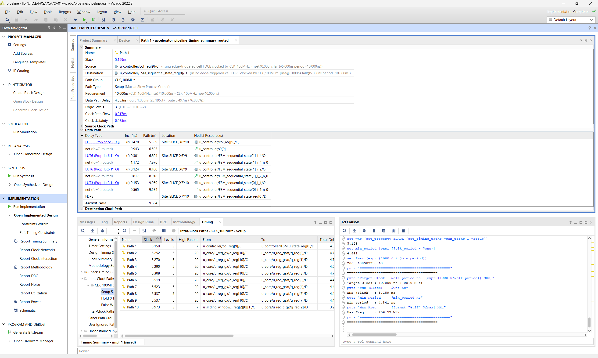

</fig>

